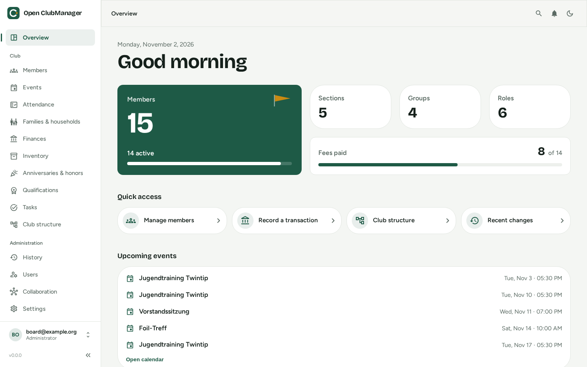

<p align="center">
  
</p>

<h1 align="center">Open ClubManager</h1>

<p align="center">
  <strong>Free desktop software for small clubs and associations (Vereine).</strong><br/>
  Members, fees, events, attendance, inventory – on your own computer, without a subscription, without a cloud account.
</p>

<p align="center">
  <a href="https://github.com/Waschndolos/open-clubmanager/actions/workflows/ci.yml"></a>
  <a href="LICENSE"></a>
  <a href="https://waschndolos.github.io/open-clubmanager/"></a>
</p>

<p align="center">
  
</p>

> 🚧 **Status: under active development.** The local mode is usable for testing; collaboration (sync between board members) is being built. There is no stable release yet – do not manage real bank data with it before the 1.0 release and the planned cryptography review.

📖 **User guide:** [English](https://waschndolos.github.io/open-clubmanager/en/) · [Deutsch](https://waschndolos.github.io/open-clubmanager/) – source in [`docs/user/`](docs/user)

---

## What is Open ClubManager?

Open ClubManager is a **desktop application** (Windows, macOS, Linux) for the day-to-day administration of small to medium-sized clubs – the kind of club that today runs on a handful of Excel sheets, a Word template for the membership form and the treasurer's memory.

It is built for the volunteers who do the work: the board, the treasurer, the secretary, the coach. You install it like any other program, create an admin account, and start. There is no server to rent, no database to install and no account to sign up for.

When several people need to work on the same data, they can switch on **collaboration**: every device keeps its own copy and exchanges **encrypted, signed changes** through a folder the club already has (Nextcloud, OneDrive, Dropbox, Google Drive or a network drive). Who may see what – e.g. a coach never receives bank details – is enforced with cryptography, not just by hiding buttons.

### What it is not

| Open ClubManager is **not** … | … because |
|---|---|
| a **web application** or SaaS | It is and will stay a desktop app. There is no hosted version, no browser login and no "open it on your phone" URL. |
| a **member portal** | Members do not log in. Only club officials use the software. |
| an **accounting system** for tax purposes | The cash book helps with fees and transactions, but it is no replacement for double-entry bookkeeping, DATEV export or your tax advisor. |
| a **communication tool** | No newsletters, no mass e-mail, no chat. You can export lists and calendars (.xlsx, .csv, .ics) and use the tools you already have. |
| a **website builder** or **online registration form** | Data is entered by officials, not by members on the internet. |
| a solution for **large federations** | It targets clubs with tens to a few thousand members, not multi-level associations with hundreds of sub-clubs. |
| **finished** | See status above. Features and data format may still change before 1.0 (migrations are handled automatically, see [migration docs](docs/user/migration/index.md)). |

## Why use it?

- **It costs nothing – forever.** AGPL licensed, no tiers, no per-member pricing.
- **Your data stays with you.** One SQLite file on your computer. No vendor sees member data, no data processing agreement with a cloud provider is needed for the local mode.
- **Works offline.** Training hall without Wi‑Fi? Attendance is recorded anyway and synced later.
- **Made for volunteers.** German-first UI (also English and French), guided wizards, demo data to try everything out.
- **No lock-in.** Open file format (SQLite), Excel export of members, GDPR data export per member (PDF + JSON), iCal export of the calendar.
- **Privacy built in.** Per-member GDPR export (Art. 15/20), audit history, police clearance certificates stored as "inspected on" date only (§ 72a SGB VIII).

## Advantages and drawbacks of the approach

Open ClubManager is deliberately **local-first**: the desktop app is the product, every device has its own database, and collaboration is a sync of encrypted changes. This is a trade-off – here it is, honestly.

### ✅ Advantages

| | |
|---|---|
| **Zero operations** | Nothing to host, patch, back up on a server or pay for. Install → use. |
| **Data sovereignty** | Data never leaves the club's devices and storage. Cloud folders only see encrypted data. |
| **Offline by default** | Works on a laptop at the general meeting, on a tablet in the gym, on the train. |
| **Real permissions** | A device that is not allowed to see bank data never gets the key for it – even if someone opens the shared folder directly. |
| **Fast** | Local database, no network round-trips; small native app (Tauri, ~10 MB). |
| **Long-lived** | If the project stopped tomorrow, the app keeps working and your data is a plain SQLite file. |

### ⚠️ Drawbacks

| | |
|---|---|
| **Installation per device** | Every official needs the app installed. No "just open a link". Updates have to be installed on each device. |
| **No access from anywhere** | No smartphone app, no browser access. If you are not at a device with the app, you cannot look something up. |
| **Members cannot self-serve** | No self-registration, no "update your own address" portal. |
| **Sync is not real-time** | Changes arrive when the cloud folder has synced (seconds to minutes). Simultaneous edits of the same field are resolved "last writer wins"; duplicate member numbers etc. are shown for manual resolution. |
| **Backups are your job** | No provider keeps backups for you. The app has a backup button – use it (and enable disk encryption, the local database is not encrypted). |
| **Key management** | Collaboration needs an emergency key that must be printed and kept safe. Losing all board devices *and* the key means losing admin control. |
| **Young project** | Own sync protocol, not yet externally reviewed. Small team of volunteers. |

If you need members to log in online, a website or a hosted multi-tenant system, a classic web-based club software is the better fit. If you want a free, private, low-maintenance tool for the board, read on.

## Features

| Area | What you can do | |
|---|---|---|
| **Members** | Master data, address, bank details & SEPA mandate, entry/exit, groups, sections, roles; Excel import with column mapping and Excel export; GDPR data export | [📷](docs/user/assets/screenshots/members.en.png) |
| **Families & households** | Households with a main payer, shared address/bank details, guardians for minors | [📷](docs/user/assets/screenshots/households.en.png) |
| **Events** | Club calendar (month/week/list), recurring events, target groups, iCal export | [📷](docs/user/assets/screenshots/events.en.png) |
| **Attendance** | Record training attendance (also offline), statistics, CSV/PDF export, trainer role | [📷](docs/user/assets/screenshots/attendance-stats.en.png) |
| **Finance** | Cash book, member fees, fee models with automatic billing runs (age limits, pro rata, duplicate protection), open items, SEPA direct debit runs (pain.008 export for your bank), CAMT.053 bank statement import with payment reconciliation (suggested matches of payments and returned debits to open fees), donation receipts after the official German template (single/collective, annual run, numbered log with duplicates) | [📷](docs/user/assets/screenshots/finance.en.png) |
| **Inventory** | Items, loans, condition, inspection schedules, maintenance log (optionally booked as expense) | [📷](docs/user/assets/screenshots/inventory.en.png) |
| **Anniversaries & honors** | Upcoming membership anniversaries and round birthdays, recorded honors, CSV export | [📷](docs/user/assets/screenshots/honors.en.png) |
| **Qualifications** | Coach licences, first aid, police clearance with expiry warnings | [📷](docs/user/assets/screenshots/qualifications.en.png) |
| **Tasks** | Tasks for board members and roles, recurring, due dates | [📷](docs/user/assets/screenshots/tasks.en.png) |
| **Administration** | Users and app roles, audit history, backup/restore, language, dark mode, global search (Ctrl/Cmd + K) | [📷](docs/user/assets/screenshots/settings.en.png) |
| **Collaboration** *(in progress)* | Invite board members, roles per device, conflict resolution, emergency key | [📷](docs/user/assets/screenshots/collaboration.en.png) |

The full, illustrated description of every feature is in the **[user guide](https://waschndolos.github.io/open-clubmanager/en/)** (also available [in German](https://waschndolos.github.io/open-clubmanager/)).

## Download

Installers for Windows (`.msi`/`.exe`), macOS (`.dmg`) and Linux (`.deb`/`.AppImage`/`.rpm`) will be published on the [Releases page](https://github.com/Waschndolos/open-clubmanager/releases) with the first release. Until then, build it yourself (see below).

## How it works

```
┌──────────────── Desktop app (Tauri) ────────────────┐
│  React UI  ──HTTP 127.0.0.1──►  Go backend (sidecar)│
│                                   │                 │
│                                   ▼                 │
│                         SQLite file on this device  │
└───────────────────────────────────┬─────────────────┘
                                    │ optional: encrypted, signed change files
                                    ▼
              Club folder (Nextcloud / OneDrive / Dropbox / network drive)
                                    ▲
                                    │
                 other board members' devices (same app)
```

- **Frontend:** React 19, TypeScript, MUI, Vite
- **Backend:** Go, Chi, OpenAPI ([`openapi.yaml`](openapi.yaml), generated with oapi-codegen), runs as a sidecar bound to `127.0.0.1`
- **Desktop shell:** Tauri 2 (Rust)
- **Database:** SQLite (pure Go driver), schema via embedded goose migrations that run automatically on start
- **Sync:** see [ADR 0001](docs/adr/0001-collaboration-and-sync-architecture.md) and the [sync protocol](docs/sync-protocol.md)

> The backend speaks HTTP only so that the desktop UI can talk to it. It is an implementation detail of the desktop app, not a web server meant to be exposed to the network.

## Development

Prerequisites: Node.js 22, Go (see `server/go.mod`), Rust + Cargo and the [Tauri prerequisites](https://tauri.app/start/prerequisites/). Or use the ready-made **Dev Container** in [`.devcontainer/`](.devcontainer).

```bash
npm run setup        # install all dependencies (root, frontend, Go modules)
npm run dev          # desktop app: frontend + backend + Tauri window
npm run dev:browser  # UI in the browser for faster frontend iteration (development only)
npm run build        # build installers into src-tauri/target/release/bundle/
npm run lint         # frontend lint + Go tests
```

On first start the app asks where to store the database and lets you create the first admin account (optionally with demo data of a kitesurf club).

<details>
<summary>Backend configuration</summary>

Settings are read from `config.json` (default `~/.config/open-clubmanager/config.json`, override with `SERVER_CONFIG_FILE`); environment variables take precedence.

| Env variable | `config.json` key | Default | Description |
|---|---|---|---|
| `PORT` | `port` | `3001` | Port of the local API |
| `BIND_ADDRESS` | `bindAddress` | `127.0.0.1` | Interface the API listens on. Keep the default – the API is meant for the desktop UI on the same machine. |
| `JWT_SECRET` / `JWT_ACCESS_SECRET` | `jwtSecret` | *generated* | Secret for login tokens. Generated on first start and stored in `jwt_secret` next to `config.json` (`0600`). |
| `JWT_SECRET_FILE` | – | `<config dir>/jwt_secret` | Alternative location of the generated secret |
| `DATABASE_PATH` | `databasePath` | `./clubmanager.db` | SQLite database file, created and migrated on first use |
| `CORS_ALLOWED_ORIGINS` | `allowedOrigins` | – | Comma-separated browser origins allowed to call the API besides the Tauri app, e.g. `http://localhost:5173` for the Vite dev server (`npm run dev:browser` sets it). Other origins get `403`. |
| `ALLOWED_HOSTS` | `allowedHosts` | – | Comma-separated host names accepted in the `Host` header besides `localhost` and IP addresses (protection against DNS rebinding). Needed only when the API is reached via a DNS name. |

> When running the backend for tests, always set `SERVER_CONFIG_FILE` and `DATABASE_PATH` to throwaway paths – otherwise setup overwrites the config of your installed app.
</details>

More: [CONTRIBUTING.md](CONTRIBUTING.md) · [Data model](docs/data-model.md) · [API reference (ReDoc)](https://waschndolos.github.io/open-clubmanager/api/) · [Architecture decisions](docs/adr)

### Documentation

The user guide is built with [MkDocs Material](https://squidfunk.github.io/mkdocs-material/) and [mkdocs-static-i18n](https://ultrabug.github.io/mkdocs-static-i18n/) from [`docs/user/`](docs/user), in German (`page.md`, default) and English (`page.en.md`), and published to GitHub Pages on every push to `main`. **Every feature PR updates both languages** – CI fails if a page of the app has no documentation page or a page has no translation. Screenshots are generated automatically with Playwright in both languages. See [docs/user/mitwirken/dokumentation.en.md](docs/user/mitwirken/dokumentation.en.md).

```bash
pip install -r docs/requirements.txt
mkdocs serve          # live preview on http://127.0.0.1:8000
```

## Contributing

Contributions, bug reports and ideas are welcome – see [CONTRIBUTING.md](CONTRIBUTING.md) and the [Code of Conduct](CODE_OF_CONDUCT.md). Commits need a DCO sign-off (`git commit -s`).

## License

Open ClubManager is free software under the **GNU Affero General Public License v3.0 or later** ([LICENSE](LICENSE)). You may use, study, modify and distribute it, also commercially. If you distribute a modified version, you must publish its source under the same license.

The software is provided "as is", without warranty. Whoever runs it is responsible for complying with data protection law (e.g. GDPR) for the member data they manage. Project name, logo and icons: see [NOTICE](NOTICE). Third-party licenses: [`licenses/`](licenses).

---

<p align="center">Built by volunteers, for volunteers. 💚</p>
