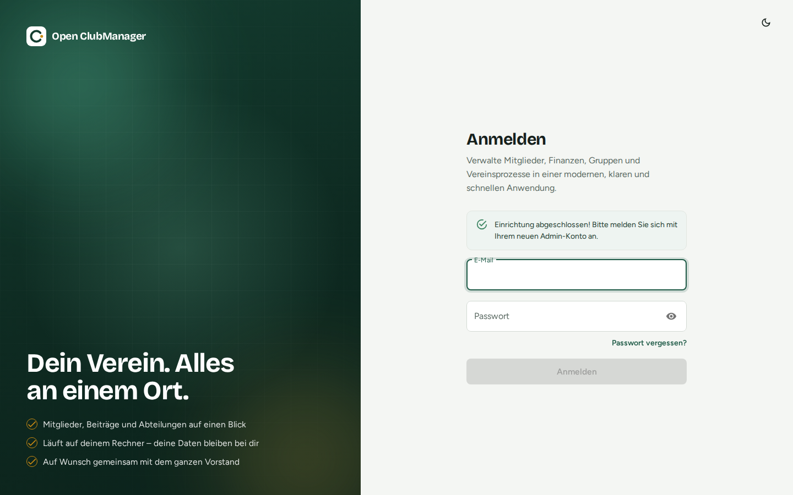

---
routes:
  - /login
  - /forgot-password
  - /reset-password
---

# Login & password

{ .screenshot }

Log in with the email address and password you set during [setup](einrichtung.md) or received from your administrator.

You stay logged in while the program is open. To log out, click your account at the bottom left of the sidebar → **Logout**.

## Changing your password

!!! note "Not available yet"
    A profile page for changing your own password exists but cannot be reached from the menu yet. Until then, an administrator can delete your account in [user management](../funktionen/benutzer.md) and create it again with a new password.

The new password must be at least 8 characters long.

!!! warning "Collaboration: your password protects the device key"
    When [collaboration](../zusammenarbeit/index.md) is turned on, your password also protects this device's key. Remember it well.

## Forgot password

**Forgot password?** sends you a reset link by email. This only works if email sending (SMTP) is configured for Open ClubManager, which is usually **not** the case in a normal desktop installation.

The link is valid for one hour and works only once; requesting a new one invalidates the old one. After the reset, all existing sessions of the account are signed out.

Without email sending:

- **You are not the only administrator:** ask another administrator to delete your user account in [user management](../funktionen/benutzer.md) and create it again.
- **You are the only administrator:** restore a [backup](../funktionen/einstellungen.md#backup) whose password you still know, or ask the [community](https://github.com/Waschndolos/open-clubmanager/issues) for help.
