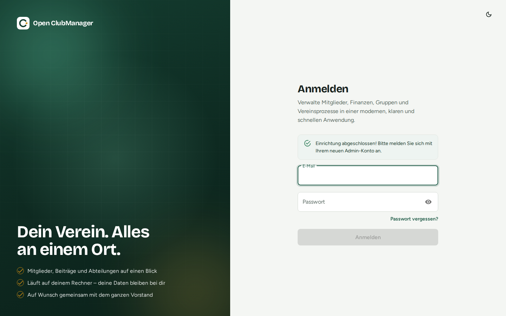

---
routes:
  - /login
  - /forgot-password
  - /reset-password
---

# Anmelden & Passwort

{ .screenshot }

Melde dich mit der E-Mail-Adresse und dem Passwort an, die du bei der [Einrichtung](einrichtung.md) oder von deinem Administrator bekommen hast.

Die Anmeldung gilt, solange das Programm geöffnet ist. Abmelden kannst du dich über dein Konto unten links in der Seitenleiste → **Abmelden**.

## Passwort ändern

!!! note "Noch nicht verfügbar"
    Eine Profilseite zum Ändern des eigenen Passworts ist vorbereitet, aber noch nicht über das Menü erreichbar. Bis dahin kann ein Administrator das Konto in der [Benutzerverwaltung](../funktionen/benutzer.md) löschen und mit neuem Passwort neu anlegen.

Das neue Passwort muss mindestens 8 Zeichen lang sein.

!!! warning "Zusammenarbeit: Passwort schützt den Geräteschlüssel"
    Wenn die [Zusammenarbeit](../zusammenarbeit/index.md) eingeschaltet ist, schützt dein Passwort auch den Schlüssel dieses Geräts. Merke es dir gut.

## Passwort vergessen

Über **Passwort vergessen?** kannst du dir einen Link zum Zurücksetzen per E-Mail schicken lassen. Das funktioniert nur, wenn für Open ClubManager ein E-Mail-Versand (SMTP) eingerichtet ist – bei einer normalen Desktop-Installation ist das in der Regel **nicht** der Fall.

Ohne E-Mail-Versand gilt:

- **Du bist nicht der einzige Administrator:** Bitte einen anderen Administrator, dein Benutzerkonto in der [Benutzerverwaltung](../funktionen/benutzer.md) zu löschen und neu anzulegen.
- **Du bist der einzige Administrator:** Spiele eine [Datensicherung](../funktionen/einstellungen.md#datensicherung) ein, deren Passwort du noch kennst, oder wende dich an die [Community](https://github.com/Waschndolos/open-clubmanager/issues).
