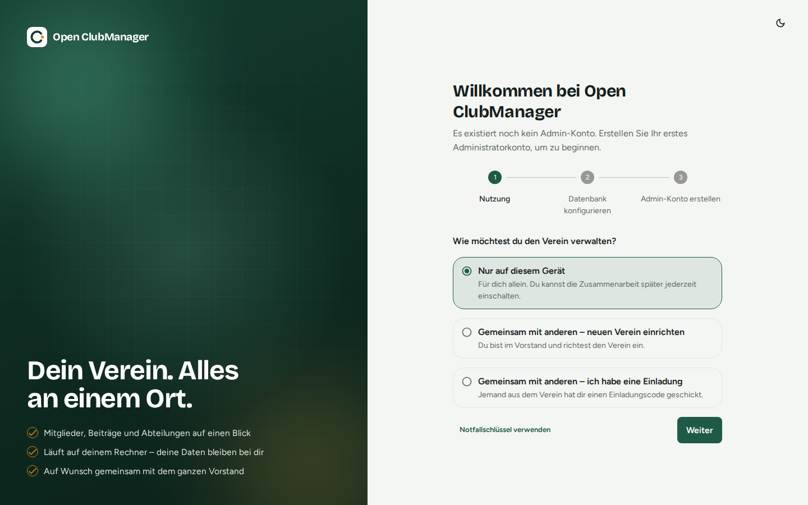
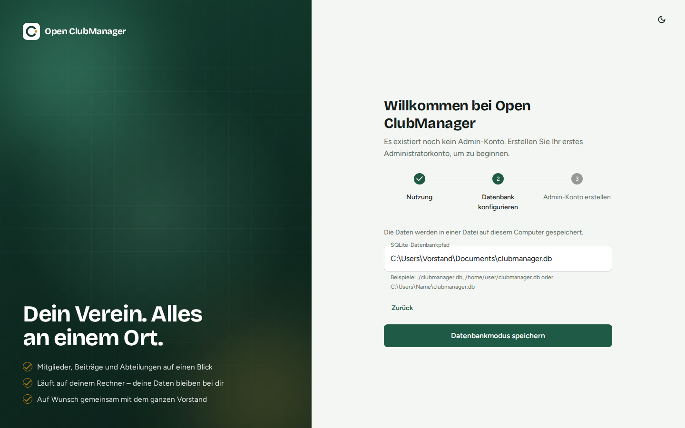
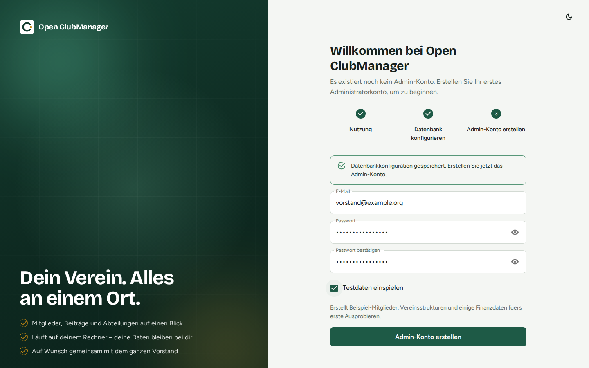

---
routes:
  - /setup
---

# First-run setup

On first start there is no user account yet, so Open ClubManager guides you through setup in three steps.

## Step 1: Choose how you'll use it

{ .screenshot }

| Option | When? |
|---|---|
| **Only on this device** | You manage the club on your own, or you just want to try it out. You can turn on [collaboration](../zusammenarbeit/index.md) at any time later. |
| **Together with others – set up a new club** | You are on the board and want several people to work with the same data. You first set up your account, then the shared club. |
| **Together with others – I have an invite** | Someone from the club sent you an invite code. |
| **Use the emergency key** (small button at the bottom) | All board devices are lost and you want to restore the club with the [emergency key](../zusammenarbeit/notfallschluessel.md). |

Click **Next**.

## Step 2: Choose the database

{ .screenshot }

Enter where the database file should be stored, for example:

- Windows: `C:\Users\Name\Documents\clubmanager.db`
- macOS: `/Users/name/Documents/clubmanager.db`
- Linux: `/home/name/clubmanager.db`

If the file doesn't exist yet, it is created. If you point to an existing Open ClubManager database, it is used.

!!! warning "Don't put it in a cloud folder"
    Do **not** put the database file into a Nextcloud, OneDrive, Dropbox or Google Drive folder or onto a network drive. It can get corrupted there while it is being synchronised. For working together, use [collaboration](../zusammenarbeit/index.md), which is built exactly for this.

## Step 3: Create the admin account

{ .screenshot }

Enter your email address and a password (at least 8 characters). This account has the role **Administrator** and may do everything.

**Import demo data** creates a fictional kitesurfing club with members, sections, events, inventory and transactions. Ideal for trying things out; leave it unticked for real use.

!!! note
    Demo data is only available with "Only on this device", so that no made-up members are distributed to the whole board.

Click **Create Admin Account**. You are then taken to the [login](anmelden.md).
