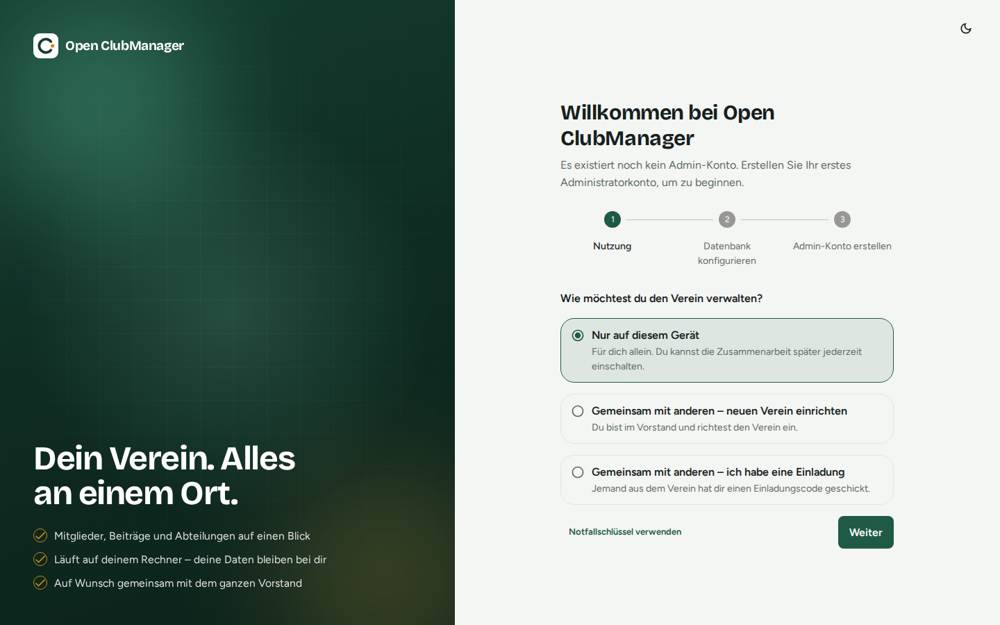
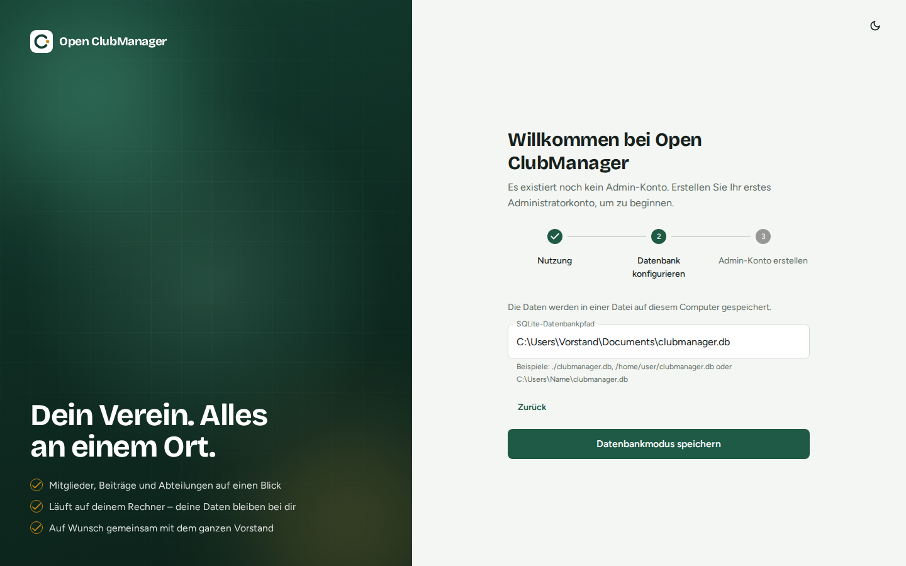
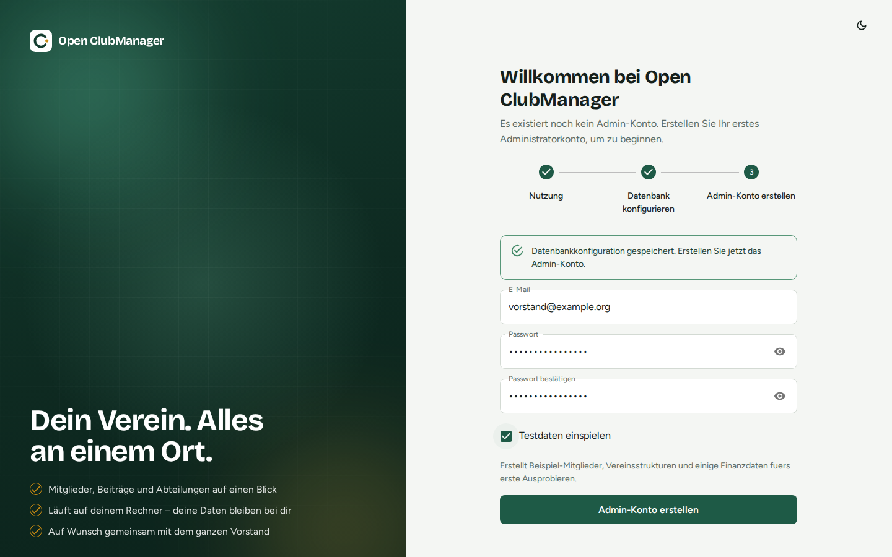

---
routes:
  - /setup
---

# Ersteinrichtung

Beim ersten Start gibt es noch kein Benutzerkonto. Open ClubManager führt dich deshalb in drei Schritten durch die Einrichtung.

## Schritt 1: Nutzung wählen

{ .screenshot }

| Auswahl | Wann? |
|---|---|
| **Nur auf diesem Gerät** | Du verwaltest den Verein allein, oder du möchtest erst einmal ausprobieren. Die [Zusammenarbeit](../zusammenarbeit/index.md) kannst du später jederzeit einschalten. |
| **Gemeinsam mit anderen – neuen Verein einrichten** | Du bist im Vorstand und möchtest, dass mehrere Personen mit denselben Daten arbeiten. Du richtest zuerst dein Konto ein, danach den gemeinsamen Verein. |
| **Gemeinsam mit anderen – ich habe eine Einladung** | Jemand aus dem Verein hat dir einen Einladungscode geschickt. |
| **Notfallschlüssel verwenden** (kleiner Knopf unten) | Alle Vorstandsgeräte sind verloren und du willst den Verein mit dem [Notfallschlüssel](../zusammenarbeit/notfallschluessel.md) wiederherstellen. |

Klicke auf **Weiter**.

## Schritt 2: Datenbank festlegen

{ .screenshot }

Gib an, wo die Datenbankdatei liegen soll, zum Beispiel:

- Windows: `C:\Users\Name\Documents\clubmanager.db`
- macOS: `/Users/name/Documents/clubmanager.db`
- Linux: `/home/name/clubmanager.db`

Gibt es die Datei noch nicht, wird sie angelegt. Zeigst du auf eine vorhandene Open-ClubManager-Datenbank, wird sie weiterverwendet.

!!! warning "Nicht in einen Cloud-Ordner legen"
    Lege die Datenbankdatei **nicht** in einen Nextcloud-, OneDrive-, Dropbox- oder Google-Drive-Ordner und nicht auf ein Netzlaufwerk. Dort kann sie beschädigt werden, wenn sie gleichzeitig synchronisiert wird. Für die gemeinsame Arbeit gibt es die [Zusammenarbeit](../zusammenarbeit/index.md), die genau dafür gebaut ist.

## Schritt 3: Admin-Konto anlegen

{ .screenshot }

Gib deine E-Mail-Adresse und ein Passwort (mindestens 8 Zeichen) ein. Dieses Konto hat die Rolle **Administrator** und darf alles.

**Testdaten einspielen** legt einen fiktiven Kitesurf-Verein mit Mitgliedern, Abteilungen, Terminen, Inventar und Buchungen an. Ideal zum Ausprobieren – für den echten Betrieb lass das Häkchen weg.

!!! note
    Beispieldaten gibt es nur bei „Nur auf diesem Gerät“, damit keine erfundenen Mitglieder an den ganzen Vorstand verteilt werden.

Klicke auf **Admin-Konto erstellen**. Danach landest du bei der [Anmeldung](anmelden.md).
