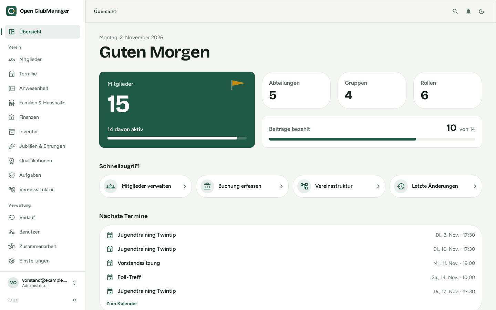
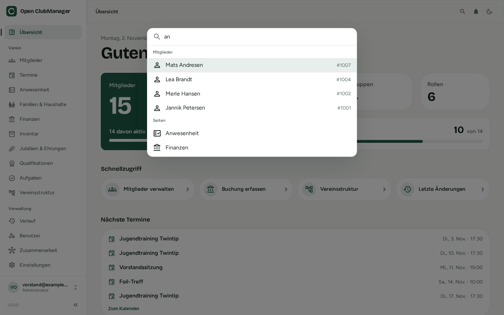

# Using the interface

{ .screenshot }

## Sidebar

On the left you find all areas, grouped into:

- **Overview**: the [start page](../funktionen/dashboard.md)
- **Club**: members, events, attendance, families & households, finances, inventory, anniversaries & honors, qualifications, tasks, club structure
- **Administration**: history, users, collaboration, settings

You only see the areas your [role](rollen.md) may see. Finances, for example, are only visible to administrators and treasurers.

Use **«** at the bottom of the sidebar to collapse it for more space. At the bottom left you see which account and role you are logged in with.

## Search and quick actions

{ .screenshot }

Press ++ctrl+k++ (macOS: ++cmd+k++) or click the magnifying glass at the top right. You can search for pages and members and start quick actions such as **New member** or **Sync now**. Use the arrow keys to select and ++enter++ to open.

## Notifications

The bell at the top right shows when something needs your attention, for example inspections due in the inventory or conflicts to resolve in collaboration.

## Light and dark mode

Use the moon or sun icon at the top right to switch between light and dark mode.

## Language

Open ClubManager is available in **German**, **English** and **French**. Set the language in the [settings](../funktionen/einstellungen.md).

## Tables

Many areas show data as a table. Everywhere:

- Clicking a column header sorts.
- The column menu (⋮) lets you filter and show or hide columns.
- The checkboxes on the left select several entries, e.g. for deleting.
