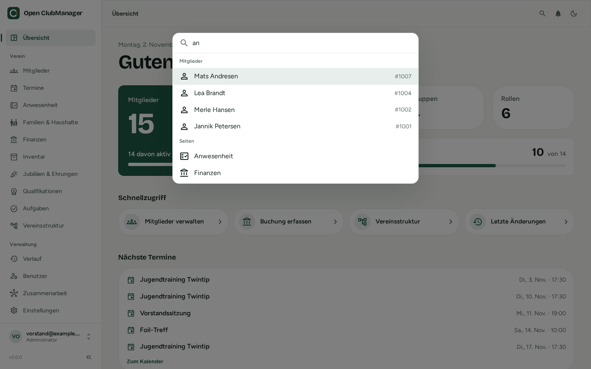

# Bedienung der Oberfläche

{ .screenshot }

## Seitenleiste

Links findest du alle Bereiche, gruppiert nach:

- **Übersicht** – die [Startseite](../funktionen/dashboard.md)
- **Verein** – Mitglieder, Termine, Anwesenheit, Familien & Haushalte, Finanzen, Inventar, Jubiläen & Ehrungen, Qualifikationen, Aufgaben, Vereinsstruktur
- **Verwaltung** – Verlauf, Benutzer, Zusammenarbeit, Einstellungen

Du siehst nur die Bereiche, die deine [Rolle](rollen.md) sehen darf. Die Finanzen sieht zum Beispiel nur, wer Administrator oder Kassenwart ist.

Mit **«** unten in der Seitenleiste klappst du sie ein, um mehr Platz zu haben. Unten links siehst du, mit welchem Konto und welcher Rolle du angemeldet bist.

## Suche und Schnellaktionen

{ .screenshot }

Drücke ++ctrl+k++ (macOS: ++cmd+k++) oder klicke oben rechts auf die Lupe. Du kannst nach Seiten und Mitgliedern suchen und Schnellaktionen starten, zum Beispiel **Neues Mitglied** oder **Sync jetzt**. Mit den Pfeiltasten wählst du aus, mit ++enter++ öffnest du.

## Benachrichtigungen

Die Glocke oben rechts zeigt, wenn etwas deine Aufmerksamkeit braucht, zum Beispiel fällige Prüfungen im Inventar oder Klärungsbedarf bei der Zusammenarbeit.

## Helles und dunkles Design

Mit dem Mond- bzw. Sonnensymbol oben rechts wechselst du zwischen hellem und dunklem Design.

## Sprache

Open ClubManager gibt es auf **Deutsch**, **Englisch** und **Französisch**. Die Sprache stellst du in den [Einstellungen](../funktionen/einstellungen.md) ein.

## Tabellen

Viele Bereiche zeigen Daten als Tabelle. Überall gilt:

- Klick auf eine Spaltenüberschrift sortiert.
- Über das Spaltenmenü (⋮) kannst du filtern und Spalten aus- oder einblenden.
- Mit den Kästchen links wählst du mehrere Einträge aus, z. B. zum Löschen.
