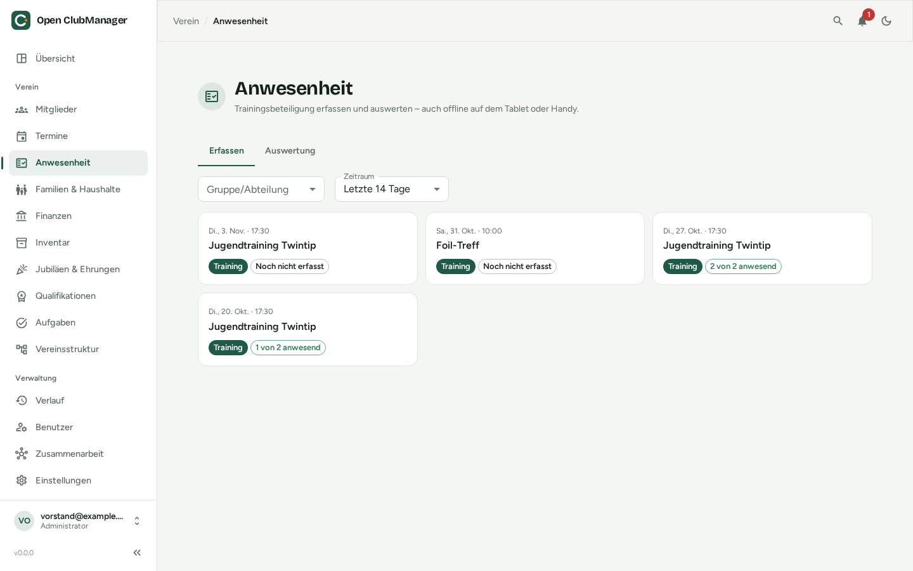
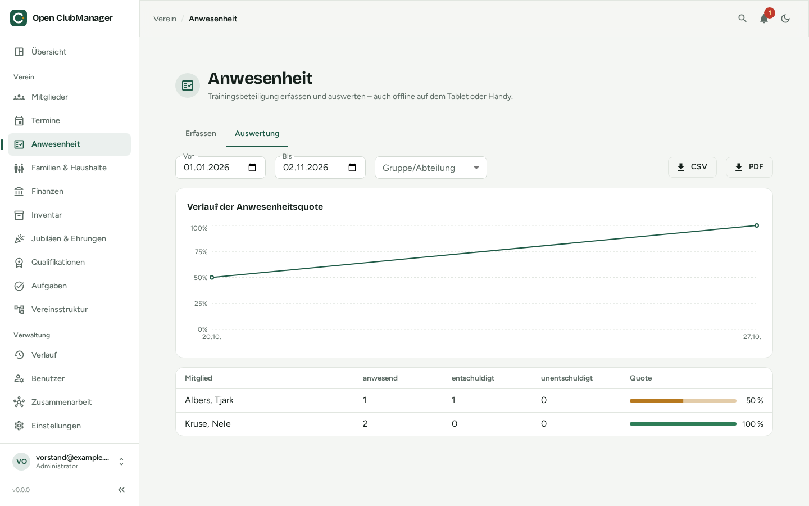

---
routes:
  - /attendance
---

# Attendance

Record who came to training and analyse participation.

{ .screenshot }

## Recording attendance

1. At the top, choose the **period** (e.g. last 14 days) and, if needed, a **group/section**.
2. Click an event. All members of the event's [audience](termine.md) are listed.
3. Mark each member as **present**, **excused** or **unexcused**. **Rest present** marks all remaining members at once.
4. **Add guest** records people who don't belong to the audience.

Each card shows whether an event has been recorded ("3 of 12 present") or not yet.

!!! tip "Works offline too"
    If you have no connection in the hall and work with [collaboration](../zusammenarbeit/index.md), the record is saved on the device and transferred automatically once the storage location is reachable again.

## Trainers

Users with the role **Trainer** only see and record events of their own groups and sections. These come from the member with the same email address as the user account. See [Users & roles](../erste-schritte/rollen.md).

## Statistics

{ .screenshot }

The **Statistics** tab shows for any period:

- the **attendance rate over time** as a chart
- per member, the number of present / excused / unexcused and the **rate**

Use **CSV** or **PDF** to export the statistics, e.g. for grant applications or the annual general meeting.
