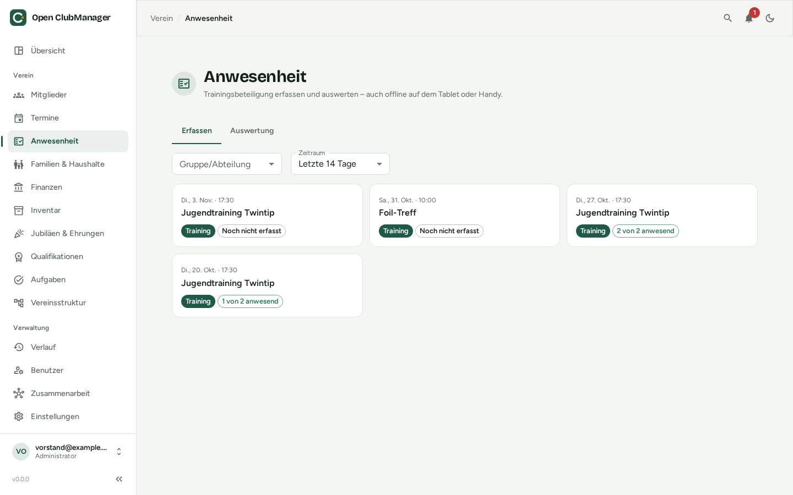
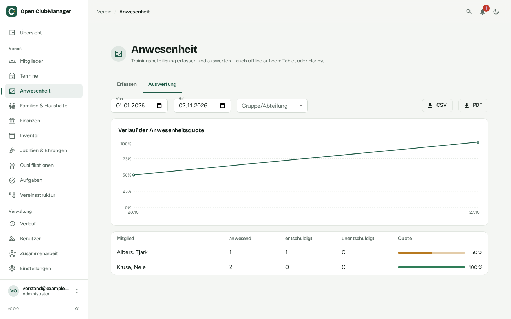

---
routes:
  - /attendance
---

# Anwesenheit

Erfasse, wer beim Training war, und werte die Trainingsbeteiligung aus.

{ .screenshot }

## Anwesenheit erfassen

1. Wähle oben den **Zeitraum** (z. B. letzte 14 Tage) und bei Bedarf eine **Gruppe/Abteilung**.
2. Klicke auf einen Termin. Angezeigt werden alle Mitglieder der Zielgruppe des [Termins](termine.md).
3. Setze für jedes Mitglied **anwesend**, **entschuldigt** oder **unentschuldigt**. Mit **Übrige anwesend** markierst du alle restlichen auf einmal.
4. Über **Gast hinzufügen** erfasst du Personen, die nicht zur Zielgruppe gehören.

Jede Karte zeigt, ob ein Termin schon erfasst ist („3 von 12 anwesend“) oder noch nicht.

!!! tip "Auch offline"
    Hast du in der Halle kein Netz und arbeitest mit [Zusammenarbeit](../zusammenarbeit/index.md), wird die Erfassung auf dem Gerät gespeichert und automatisch übertragen, sobald der Speicherort wieder erreichbar ist.

## Trainer

Benutzer mit der Rolle **Trainer** sehen und erfassen nur die Termine ihrer eigenen Gruppen und Abteilungen. Welche das sind, ergibt sich aus dem Mitglied mit derselben E-Mail-Adresse wie das Benutzerkonto. Siehe [Benutzer & Rollen](../erste-schritte/rollen.md).

## Auswertung

{ .screenshot }

Im Reiter **Auswertung** siehst du für einen frei wählbaren Zeitraum:

- den **Verlauf der Anwesenheitsquote** als Diagramm
- je Mitglied die Anzahl anwesend / entschuldigt / unentschuldigt und die **Quote**

Mit **CSV** oder **PDF** exportierst du die Auswertung, z. B. für Zuschussanträge oder die Jahreshauptversammlung.
