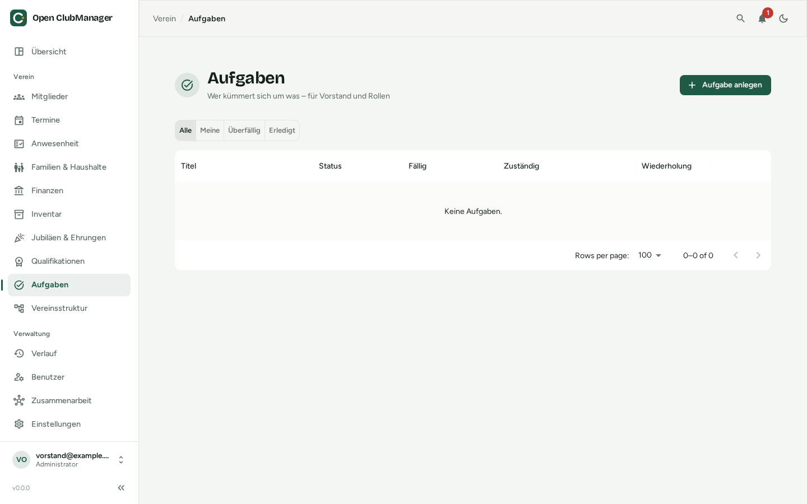

---
routes:
  - /tasks
---

# Tasks

Who takes care of what? Tasks for the board and for roles in the club.

{ .screenshot }

## Adding a task

Click **Add task** and enter:

- **Title** and **description**
- **Due**: the due date
- **Assigned to**: nobody, a **member** or a **role** (e.g. "Treasurer"). With a role, everybody who has that role is responsible.
- **Recurrence**: once, weekly, monthly or yearly. Recurring tasks need a due date. When a recurring task is done, the next one is created automatically.
- **Linked member** (optional), e.g. "Get the badge of honor for Anna"

## Status and filters

A task is **Open**, **In progress** or **Done**. Overdue tasks are highlighted.

The filters at the top show **All**, only **Mine**, only **Overdue** or only **Done**. Your open tasks are also shown on the [overview](dashboard.md).

!!! example "Examples of recurring tasks"
    - Yearly: prepare the fee collection, invite to the annual general meeting, apply for the sports grant
    - Monthly: import the bank statement
    - Weekly: return the hall key
