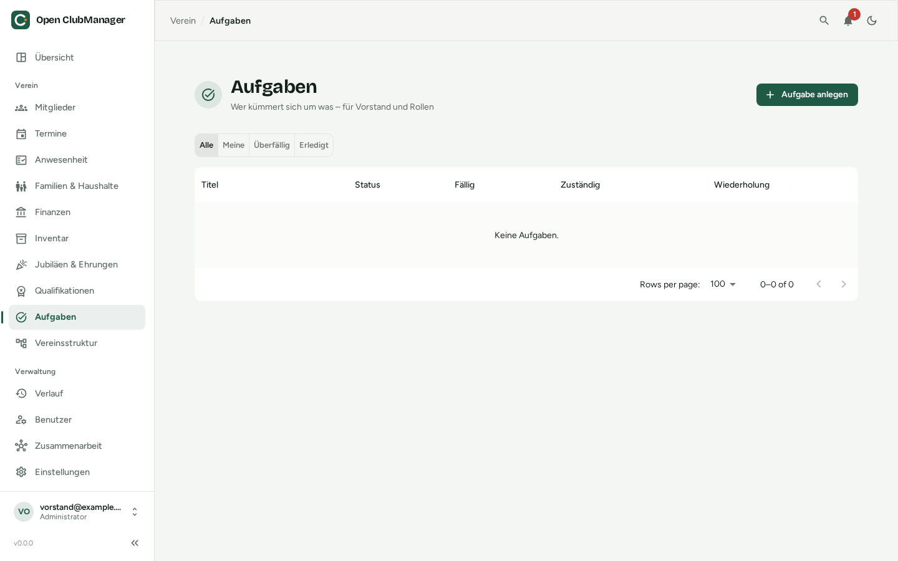

---
routes:
  - /tasks
---

# Aufgaben

Wer kümmert sich um was? Aufgaben für den Vorstand und für Rollen im Verein.

{ .screenshot }

## Aufgabe anlegen

Klicke auf **Aufgabe anlegen** und gib an:

- **Titel** und **Beschreibung**
- **Fällig** – das Fälligkeitsdatum
- **Zuständig** – niemand, ein **Mitglied** oder eine **Rolle** (z. B. „Kassenwart“). Bei einer Rolle sind alle zuständig, die diese Rolle haben.
- **Wiederholung** – einmalig, wöchentlich, monatlich oder jährlich. Wiederkehrende Aufgaben brauchen ein Fälligkeitsdatum. Wird eine wiederkehrende Aufgabe erledigt, entsteht automatisch die nächste.
- **Verknüpftes Mitglied** (optional) – z. B. „Ehrennadel für Anna besorgen“

## Status und Filter

Eine Aufgabe ist **Offen**, **In Arbeit** oder **Erledigt**. Überfällige Aufgaben sind markiert.

Mit den Filtern oben zeigst du **Alle**, nur **Meine**, nur **Überfällig** oder nur **Erledigt**. Deine offenen Aufgaben siehst du auch auf der [Übersicht](dashboard.md).

!!! example "Beispiele für wiederkehrende Aufgaben"
    - Jährlich: Beitragseinzug vorbereiten, Jahreshauptversammlung einladen, Zuschussantrag beim Landessportbund
    - Monatlich: Kontoauszug importieren
    - Wöchentlich: Hallenschlüssel zurückgeben
