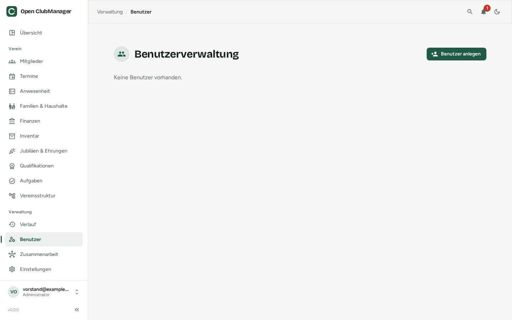

---
routes:
  - /users
---

# User management

Here **administrators** create the accounts used to log in to this Open ClubManager.

{ .screenshot }

## Creating a user

1. Click **Create User**.
2. Enter the email address, an initial password (at least 8 characters) and the [role](../erste-schritte/rollen.md).
3. Share the login details with the person in a secure way.

Each email address can belong to only one account – the administrator's address from the setup can't be used a second time either. Upper and lower case don't matter.

## Changing the role and deleting users

Use the actions in the list to change the role or delete an account. Deleted accounts can no longer log in; their changes remain visible in the [history](verlauf.md).

!!! info "Users or collaboration?"
    User accounts only apply to **this one device**, e.g. when several people share a club PC. If several people should work on **their own devices**, use [collaboration](../zusammenarbeit/index.md).
