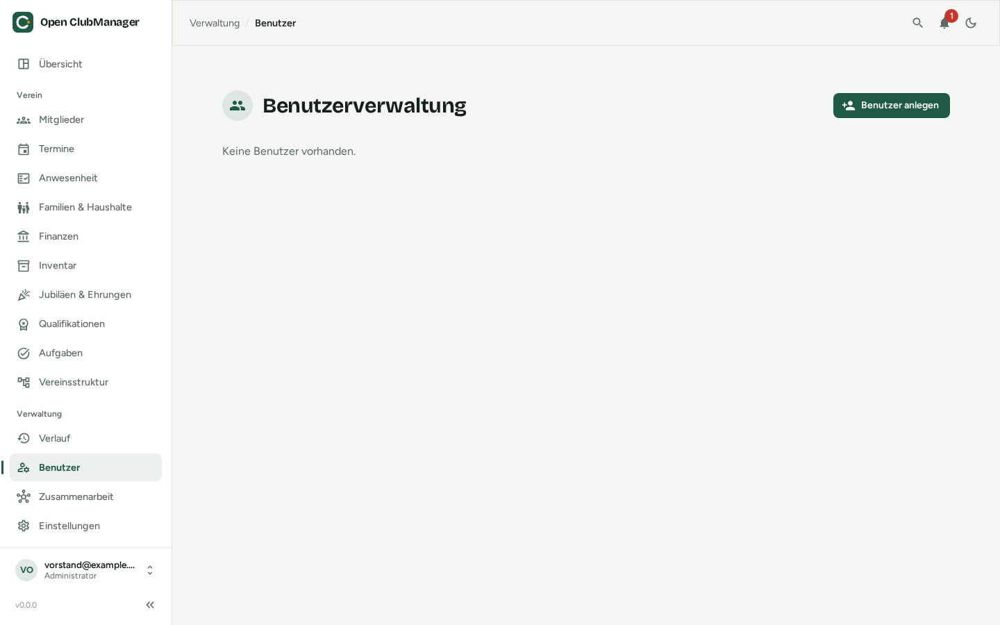

---
routes:
  - /users
---

# Benutzerverwaltung

Hier legen **Administratoren** die Konten an, mit denen man sich an diesem Open ClubManager anmeldet.

{ .screenshot }

## Benutzer anlegen

1. Klicke auf **Benutzer anlegen**.
2. Gib E-Mail-Adresse, ein Startpasswort (mindestens 8 Zeichen) und die [Rolle](../erste-schritte/rollen.md) ein.
3. Teile der Person die Zugangsdaten auf sicherem Weg mit.

## Rolle ändern und Benutzer löschen

Über die Aktionen in der Liste änderst du die Rolle oder löschst ein Konto. Gelöschte Konten können sich nicht mehr anmelden; ihre Änderungen bleiben im [Verlauf](verlauf.md) sichtbar.

!!! info "Benutzer oder Zusammenarbeit?"
    Benutzerkonten gelten nur für **dieses eine Gerät** – z. B. wenn sich mehrere Personen einen Vereins-PC teilen. Sollen mehrere Personen auf **ihren eigenen Geräten** arbeiten, nutzt die [Zusammenarbeit](../zusammenarbeit/index.md).
