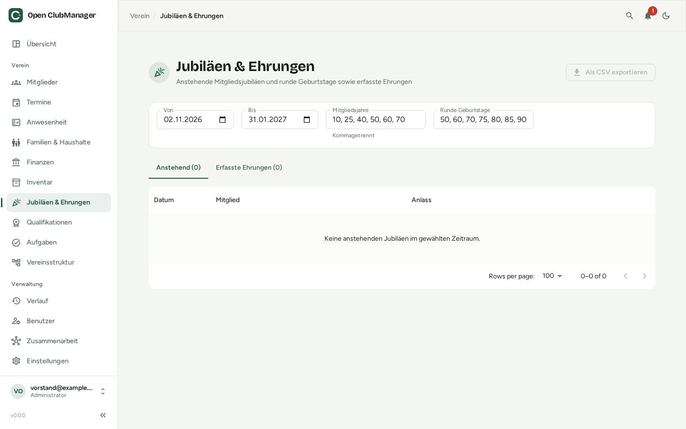

---
routes:
  - /honors
---

# Anniversaries & honors

Never miss a round membership anniversary or birthday again, and keep track of who received which honor.

{ .screenshot }

## Upcoming anniversaries

In the **Upcoming** tab, choose a period (**From** / **To**), e.g. up to the next annual general meeting. Open ClubManager lists all members who, in that period,

- have a **membership anniversary** (e.g. 10, 25, 40, 50 years), calculated from the entry date, or
- celebrate a **round birthday** (e.g. 50, 60, 70).

Set which milestones apply in the **Membership years** and **Round birthdays** fields (comma separated, e.g. `10, 25, 40, 50, 60`).

**Export as CSV** gives you the list, e.g. for printing certificates.

## Recording an honor

When a member has received an honor, click **Record honor** and enter e.g. "Silver badge of honor" and a note. Recorded honors are listed in the **Recorded honors** tab; that milestone is no longer suggested. If you delete an honor, the milestone is suggested again.

## Correcting membership years

If a member left in between or the entry date is unknown, correct the membership years: the correction in years is added to the calculated years (e.g. `-3` for a three-year break).
