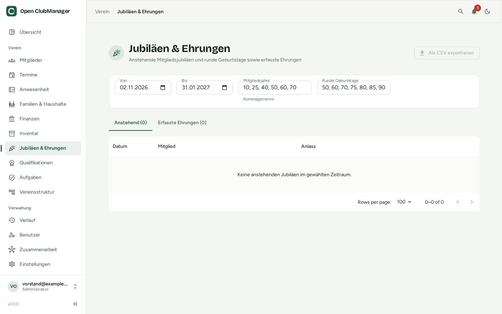

---
routes:
  - /honors
---

# Jubiläen & Ehrungen

Verpasse keine runden Mitgliedsjubiläen und Geburtstage mehr – und halte fest, wer welche Ehrung bekommen hat.

{ .screenshot }

## Anstehende Jubiläen

Im Reiter **Anstehend** wählst du einen Zeitraum (**Von** / **Bis**), z. B. bis zur nächsten Jahreshauptversammlung. Open ClubManager zeigt alle Mitglieder, die in diesem Zeitraum

- ein **Mitgliedsjubiläum** haben (z. B. 10, 25, 40, 50 Jahre), berechnet aus dem Eintrittsdatum, oder
- einen **runden Geburtstag** feiern (z. B. 50, 60, 70).

Welche Stufen gelten, legst du in den Feldern **Mitgliedsjahre** und **Runde Geburtstage** fest (kommagetrennt, z. B. `10, 25, 40, 50, 60`).

Mit **Als CSV exportieren** bekommst du die Liste, z. B. für die Urkunden.

## Ehrung erfassen

Hat ein Mitglied eine Ehrung bekommen, klicke auf **Ehrung erfassen** und trage z. B. „Ehrennadel Silber“ und eine Notiz ein. Erfasste Ehrungen findest du im Reiter **Erfasste Ehrungen**; die erledigte Stufe wird nicht mehr vorgeschlagen. Löschst du eine Ehrung, wird die Stufe wieder vorgeschlagen.

## Mitgliedsjahre korrigieren

War ein Mitglied zwischendurch ausgetreten oder ist das Eintrittsdatum unbekannt, korrigierst du die Mitgliedsjahre: Die Korrektur in Jahren wird zu den berechneten Jahren addiert (z. B. `-3` bei drei Jahren Unterbrechung).
