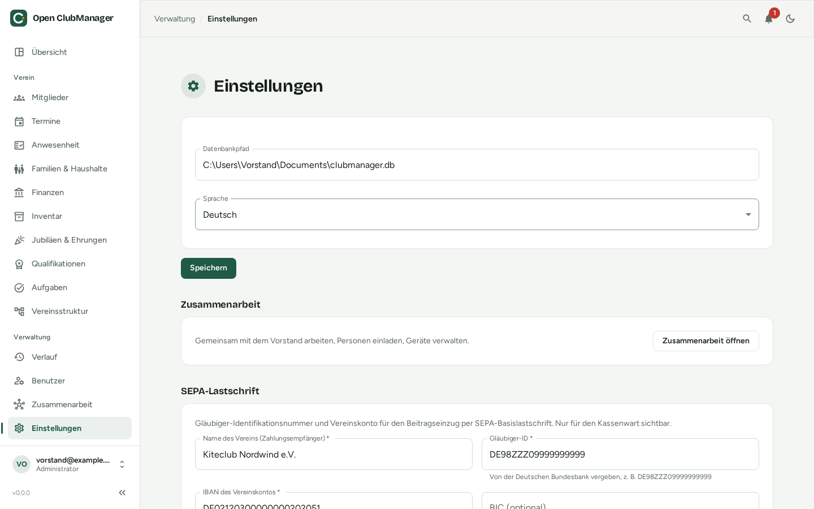

---
routes:
  - /settings
---

# Settings & backup

{ .screenshot }

## Database path

Shows which database file Open ClubManager uses. You can switch to another file here, e.g. after [moving to a new computer](../migration/neuer-computer.md). Open ClubManager checks whether the path is a valid database or whether one can be created there.

## Language

German, English or French. The setting applies to this device.

## SEPA direct debit

Only visible to administrators and treasurers. Here you enter the details for [collecting fees by direct debit](finanzen.md#direct-debit-sepa):

- **Club name (creditor)**
- **Creditor identifier**, issued by your national bank, e.g. `DE98ZZZ09999999999`
- **IBAN of the club account** and optionally the **BIC** (not needed for domestic payments)
- **Remittance template**, with placeholders that are replaced by the member's and fee's data in each run

## Collaboration

A short status of [collaboration](../zusammenarbeit/index.md) and a link to its settings.

## Backup

!!! danger "You are responsible for backups"
    Open ClubManager only stores the data on your computer. If the disk fails or the laptop is stolen and there is no backup, the data is gone. With collaboration the other devices also have the data, but that still doesn't replace a backup.

### Creating a backup

Click **Back up now**. Open ClubManager creates a `.zip` file with the complete database. Below the button you see when the last backup was made.

Recommendations:

- back up **regularly**, e.g. monthly and before every update
- keep the backup **in another place** (USB stick, external drive, encrypted cloud storage)
- **protect** the backup: it contains all member and bank data

### Restoring a backup

1. Click **Select backup file (.zip)** and choose the backup.
2. Click **Restore backup** and confirm.
3. **Restart Open ClubManager.**

Restoring **overwrites** the current data completely. If in doubt, back up the current state first.
