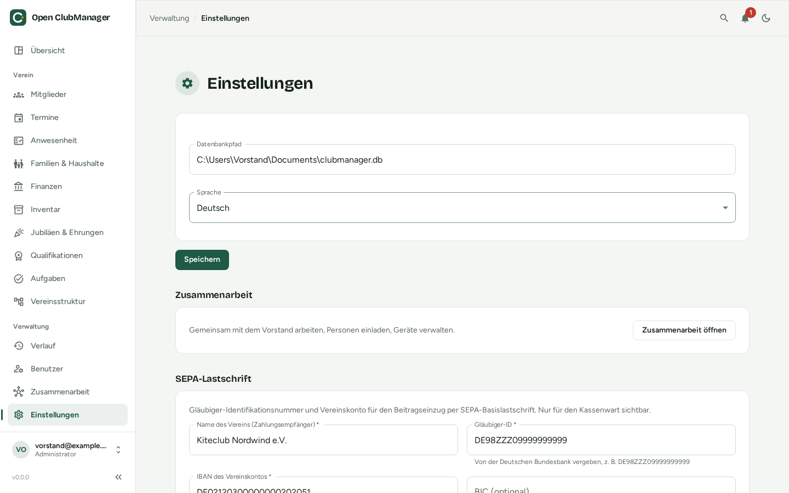

---
routes:
  - /settings
---

# Einstellungen & Datensicherung

{ .screenshot }

## Datenbankpfad

Zeigt, welche Datenbankdatei Open ClubManager verwendet. Du kannst hier auf eine andere Datei umstellen, z. B. nach einem [Umzug auf einen neuen Computer](../migration/neuer-computer.md). Open ClubManager prüft, ob der Pfad eine gültige Datenbank ist oder dort eine angelegt werden kann.

## Sprache

Deutsch, Englisch oder Französisch. Die Einstellung gilt für dieses Gerät.

## SEPA-Lastschrift

Nur sichtbar für Administratoren und Kassenwarte. Hier hinterlegst du die Daten für den [Beitragseinzug per Lastschrift](finanzen.md#lastschrift-sepa):

- **Name des Vereins (Zahlungsempfänger)**
- **Gläubiger-ID** – von der Deutschen Bundesbank vergeben, z. B. `DE98ZZZ09999999999`
- **IBAN des Vereinskontos** und optional die **BIC** (für Inlandszahlungen nicht nötig)
- **Vorlage Verwendungszweck** – mit Platzhaltern, die beim Lauf durch die Daten des Mitglieds und Beitrags ersetzt werden

## Zusammenarbeit

Kurzinfo zum Stand der [Zusammenarbeit](../zusammenarbeit/index.md) und Link zu ihren Einstellungen.

## Datensicherung

!!! danger "Du bist für die Sicherung verantwortlich"
    Open ClubManager speichert die Daten nur auf deinem Computer. Geht die Festplatte kaputt oder wird der Laptop gestohlen und es gibt keine Sicherung, sind die Daten weg. Bei eingeschalteter Zusammenarbeit haben zwar auch die anderen Geräte die Daten – eine Sicherung ersetzt das trotzdem nicht.

### Sicherung erstellen

Klicke auf **Jetzt sichern**. Open ClubManager erstellt eine `.zip`-Datei mit der kompletten Datenbank. Darunter siehst du, wann zuletzt gesichert wurde.

Empfehlung:

- **regelmäßig** sichern, z. B. monatlich und vor jedem Update
- die Sicherung **an einem anderen Ort** aufbewahren (USB-Stick, externe Festplatte, verschlüsselter Cloud-Speicher)
- die Sicherung **schützen** – sie enthält alle Mitglieder- und Bankdaten

### Sicherung einspielen

1. Klicke auf **Backup-Datei auswählen (.zip)** und wähle die Sicherung.
2. Klicke auf **Backup einspielen** und bestätige.
3. **Starte Open ClubManager neu.**

Das Einspielen **überschreibt** die aktuellen Daten vollständig. Erstelle vorher eine Sicherung des aktuellen Stands, wenn du unsicher bist.
