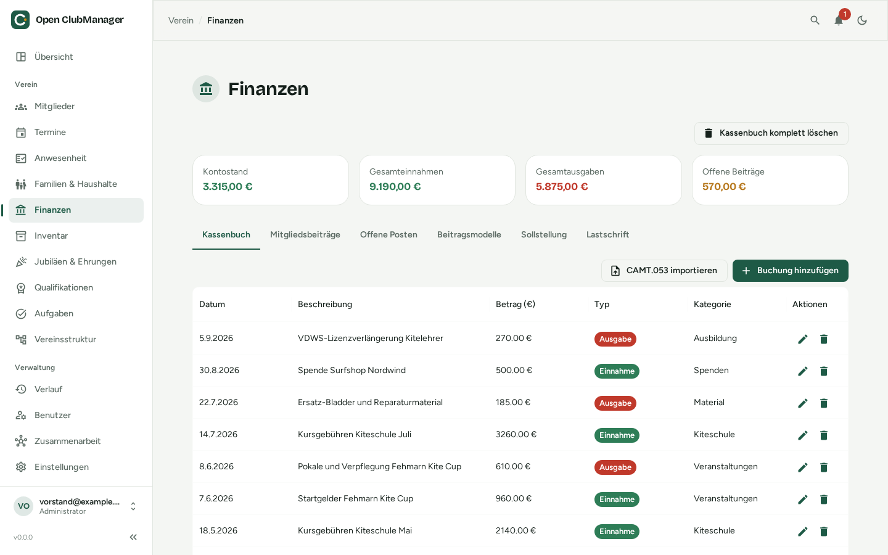
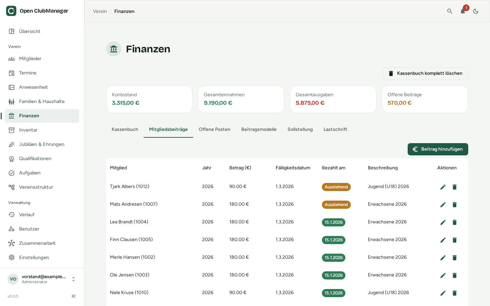
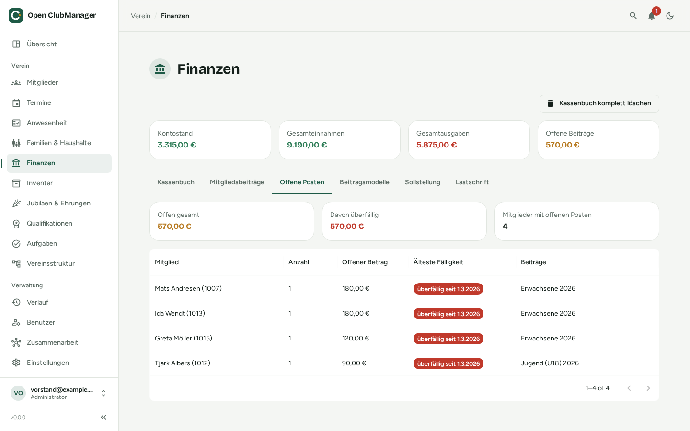
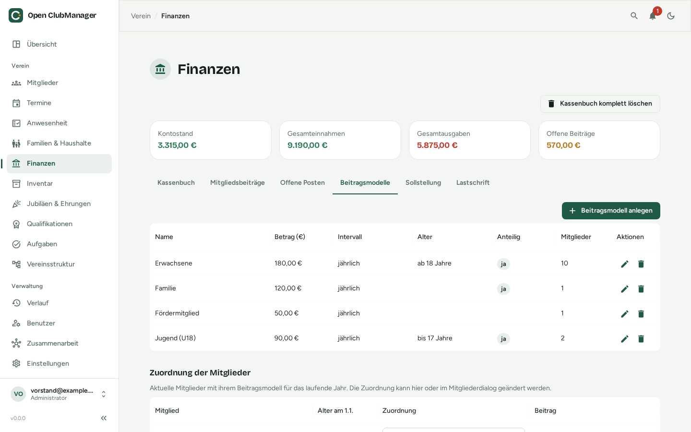
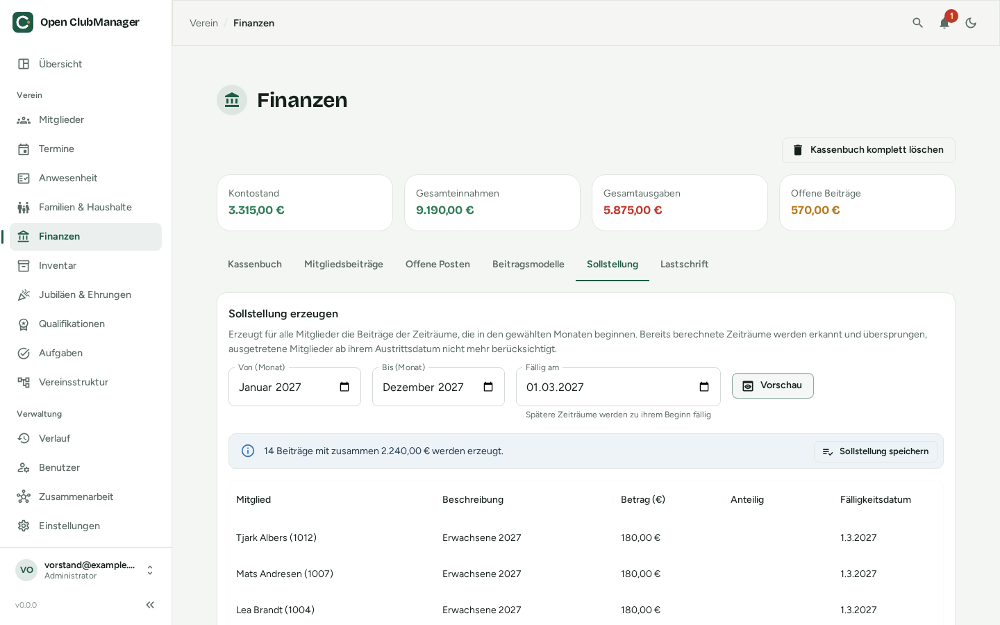
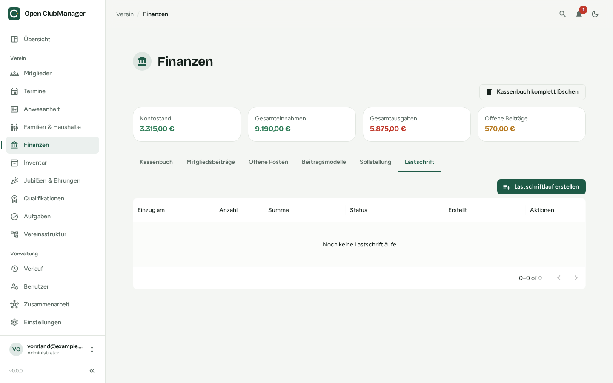
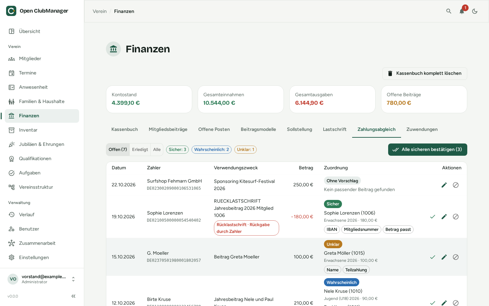

---
routes:
  - /finance
---

# Finances

Cash book, member fees, fee models with automatic billing runs, open items, fee collection by SEPA direct debit and payment reconciliation with the bank statement. Only visible to **administrators** and **treasurers**.

{ .screenshot }

At the top you see the **balance**, **total income**, **total expenses** and **outstanding fees**.

## Cash book

Every income and expense is a transaction with date, description, amount, type (income/expense), category and notes.

- **Add Transaction** creates a new transaction.
- Use the pencil and bin icons to edit or delete transactions.

Costs from [maintenance in the inventory](inventar.md#inspection-maintenance) can be booked straight into the cash book as an expense.

### Importing a bank statement (CAMT.053)

Instead of typing every transaction, import your bank's statement in **CAMT.053** format (XML). Most banks offer this in online banking, often under "export statement" or "export transactions → CAMT".

1. Click **Import CAMT.053** and select the file.
2. Open ClubManager creates a transaction for every bank movement: credits as income, debits as expenses. The payer's name and IBAN and the direct debit references are kept for the [payment reconciliation](#payment-reconciliation).
3. Afterwards you see a summary of how many transactions were imported, and for how many there is a suggestion which open fee they pay. **Open reconciliation** takes you straight to the review.

!!! warning "Current limitations"
    Import each statement **only once**. Already imported movements are not detected yet and would be booked twice.

## Member fees

{ .screenshot }

Here you manage the fees per member and year: amount, due date, paid date and description. Open fees are marked as **Unpaid**.

A fee counts as paid once you enter the paid date, a [direct debit run](#direct-debit-sepa) is confirmed, or enough payments are assigned to it in the [payment reconciliation](#payment-reconciliation). A **partly paid** fee stays unpaid until the rest arrives.

Add single fees (e.g. an admission fee) with **Add Member Fee**. The regular fees of all members are better created at once from [fee models](#fee-models) with a [billing run](#billing-run).

## Open items

{ .screenshot }

The **Open items** tab shows all unpaid fees, grouped per member: number of fees, open amount, oldest due date and which fees they are. At the top you see the **total open amount**, how much of it is **overdue** and how many members have open items. Overdue items are marked red. Members with the highest open amount come first.

## Fee models

{ .screenshot }

A fee model is one of your club's fee classes, e.g. *adults*, *youth*, *family*, *passive* or *reduced*. Create them in the **Fee models** tab with **Add fee model**:

| Field | Meaning |
|---|---|
| **Name** | Used in the description of the created fees, e.g. "Adults 2027". Must be unique. |
| **Amount** | Amount **per period** of the interval (for *quarterly*, the quarterly fee). |
| **Interval** | yearly, half-yearly, quarterly or monthly. Periods follow the calendar year (first half = January–June, first quarter = January–March, …). |
| **Minimum / maximum age** | Optional. Models with an age limit are assigned automatically by age (see below). Both limits are inclusive: *maximum age 17* means "up to and including 17". |
| **Pro rata** | When members join or leave during a period, charge only the months of membership (see [Pro rata](#pro-rata)). |

A changed amount applies to all future billing runs; fees already created stay unchanged.

### Which member pays which model?

**Member assignments** lists all current members with their age on 1 January and the fee they pay this year. Change the assignment right in the list or in the [member dialog](mitglieder.md#adding-or-editing-a-member) under **Membership → Fee model**:

- **Automatic by age** (default): the member gets the model with an age limit that fits their age. If several fit, the one with the narrowest age range wins (e.g. *students 18–27* before *adults 18 and over*).
- **A specific model**, e.g. *family* or *passive*: applies regardless of age.
- **Exempt from fees**, e.g. for honorary members: the member gets no fees.

!!! info "Coming of age"
    What counts is the **age on 1 January of the fee year**. A member who turns 18 in June still pays the youth fee that year and the adult fee automatically from the next year. This way the change never leaves a gap or charges twice, even if the two models have different intervals.

Members without a birthday or without a matching model are marked yellow and skipped by billing runs. When a model is deleted, its members get their model by age again.

## Billing run

{ .screenshot }

A billing run creates the fees of all members for a range at once, typically at the start of the year for the whole year.

1. In the **Billing run** tab, choose the range: **From (month)** and **To (month)**, e.g. January to December 2027. All fee periods that **start** in these months are charged.
2. Set **Due on**, e.g. 1 March. Periods that start later (e.g. the third quarter) are due when they start.
3. Click **Preview**. Nothing is saved yet. The preview shows the **number and total** of the fees, every single fee with amount and due date, and below who is skipped and why:
    - **already charged**: the member already has a fee from a billing run for this period,
    - **without a matching fee model**: e.g. the birthday is missing,
    - **exempt from fees**.
4. If everything is right, **Save billing run**. The fees appear under [Member fees](#member-fees) and [Open items](#open-items) and can be collected by [direct debit](#direct-debit-sepa) as usual.

**Previous billing runs** lists every saved run with the number of fees, the total and how many fees are already paid.

### No duplicate fees

Open ClubManager records which period every created fee is for. A period that has already been charged to a member is **never charged a second time**:

- If you start the same billing run again, the preview shows "nothing to charge" and saving is refused.
- If the range overlaps an earlier run, only the missing periods are charged. So you can, for example, repeat the run in summer to charge **members who joined since**.
- If you delete a created fee, its period is free again and can be charged again.

!!! warning "Fees added by hand"
    This only applies to fees from a billing run. If you have already added fees of a period by hand with **Add Member Fee** (e.g. the yearly fee before switching to fee models), they would be charged a second time. Start the first billing run with the next period, or delete the open fees added by hand first.

To undo a billing run created by mistake, use the bin icon in **Previous billing runs**: all open fees of the run are deleted, paid ones stay. If fees are in a [direct debit run](#direct-debit-sepa) that has not been confirmed, cancel or confirm that run first.

### Joining and leaving

- Members who **left** are no longer charged from their exit date: periods that start on or after the exit date get no fee. On the exit date itself the person is no longer a member.
- Members who **join** only after a period has ended get no fee for that period.

### Pro rata

Without the **Pro rata** option, the full amount is due for a period as soon as the person is a member on at least one day of it. With **Pro rata**, every month of the period counts in which the person is a member on at least one day; the corresponding share is charged, rounded to the cent.

| Example (yearly fee €120, pro rata) | Months | Fee |
|---|---|---|
| Joins on 1 or 30 April | April–December = 9 | €90.00 |
| Leaves on 1 July (last day: 30 June) | January–June = 6 | €60.00 |
| Joins 15 March, leaves 20 August | March–August = 6 | €60.00 |

In the preview, pro rata fees are marked "pro rata of …".

## Direct debit (SEPA)

{ .screenshot }

In the **Direct debit** tab you collect open fees by SEPA Core direct debit. Open ClubManager creates a file in the **pain.008** bank format that you upload in online banking. The tab only appears if your role may edit finances and, with [collaboration](../zusammenarbeit/index.md), your device receives bank and finance data.

### One-time setup

1. In the [settings](einstellungen.md#sepa-direct-debit) under **SEPA direct debit**, enter the club name, the **creditor identifier** (issued by your national bank, e.g. `DE98ZZZ09999999999`), the **IBAN of the club account** and optionally a **remittance template**.
2. For every member who pays by direct debit, enter the IBAN, **SEPA Mandate Date** and a unique **mandate reference** (e.g. `NW-1001`) under **Bank Details** in the [member dialog](mitglieder.md#adding-or-editing-a-member).

### Creating a direct debit run

Click **Create direct debit run**. A wizard guides you through three steps:

1. **Select fees:** all open fees are listed; partly paid fees with the amount still due. Fees that can't be collected (no IBAN, no mandate, no mandate reference, invalid IBAN …) are listed under **Cannot be collected** with the reason; complete the member's data.
2. **Due date & remittance:** the **collection date**. The file must reach the bank at least one business day before. Below it you see a preview of the remittance text.
3. **Review & export:** check the count, total, first (FRST) and recurring (RCUR) collections, then click **Create & download**.

The fees are then marked as **Being collected**.

### After the export

| Step | Where |
|---|---|
| Upload the `.xml` file in online banking and authorise it | at your bank |
| Once the bank has collected: **Confirm as paid** and enter the date; all fees of the run are marked as paid | the run in the list |
| Returned debits: import the bank statement and confirm them in the reconciliation; the fee is open again and can be collected once more | [Payment reconciliation](#returned-direct-debits) |
| Created a run by mistake? **Cancel run** and the fees are open again. Then don't upload the file, or revoke the order at the bank | the run in the list |

**Download XML file** gives you a run's file again.

!!! info "First and recurring collections"
    When a mandate is used for the first time, Open ClubManager marks the debit as a first collection (FRST), afterwards as recurring (RCUR). This happens automatically.

## Payment reconciliation

{ .screenshot }

In the **Reconciliation** tab you assign imported incoming payments to open fees instead of looking up every transfer by hand. Open ClubManager suggests which fees each transaction pays; **nothing is booked until you confirm**. Like [direct debit](#direct-debit-sepa), the tab only appears if your role may edit finances and your device receives bank and finance data.

### How suggestions are made

For every incoming payment Open ClubManager checks:

- the **member number** in the remittance text, e.g. "Fee 2026 member 1013" or "No. 12" (short numbers only with a word such as "Mitglied", "member", "Nr.", "No." or "#" in front),
- the **payer's IBAN** against the members' bank details,
- the **name** of the payer and in the remittance text, also with umlauts ("Möller" = "Moeller") and small typos,
- the **amount**: does it match one open fee, all open fees of the member, or of their [household](haushalte.md)?

This gives the **match quality**:

| Match quality | Meaning |
|---|---|
| **Certain** | Member number or IBAN recognised and the amount matches exactly |
| **Probable** | Member number or IBAN recognised but the amount differs (partial or overpayment), or name and amount match |
| **Unclear** | Only the name matches, not the amount; check carefully |
| **No suggestion** | No matching open fee, e.g. for donations or sponsoring |

The chips below a suggestion show what it was recognised by (e.g. *Member number*, *IBAN*, *Amount matches*, *Household*, *Partial payment*).

### Reviewing and confirming

- **Confirm** (tick) takes over the suggestion. The fee gets the booking date as paid date.
- **Confirm all certain** takes over all suggestions rated *Certain* at once.
- **Change assignment** (pencil) opens a searchable list of all open fees. Tick the right fees and adjust the amounts; this is how you correct a suggestion or assign a transaction without one yourself.
- **Mark as reviewed without fee** is for a transaction that pays no fee (e.g. a donation). It disappears from the open transactions.
- **Undo** (under **Done**) takes an assignment back. The fees return to their previous state.

### Partial payments and collective transfers

- If a member pays in **instalments**, assign every instalment to the same fee. The fee stays *Unpaid* until the total is reached; a direct debit then only collects the rest.
- If parents pay for **several children** at once, the suggestion splits the amount across the household's fees. In the dialog you can pick any number of fees, also of different members, each with its own amount.
- If an overpayment leaves a rest, it is shown and not assigned to any fee.

### Returned direct debits

Open ClubManager recognises a returned direct debit on import by its bank code or return reason and shows it in red with the reason, e.g. *Insufficient funds* or *Refund requested by payer*. The suggestion names the fee that had been paid: reliably by the debit reference for runs created in Open ClubManager, otherwise by IBAN, member number and amount.

When you confirm the returned debit, the fee is **open** again and can be collected in a new [direct debit run](#direct-debit-sepa). Bank charges for the return remain as a rest without fee.

!!! tip "Trying it with the demo data"
    If you chose the demo data during setup, you can try the reconciliation with the example file [`testdata/camt053-reconciliation.xml`](https://github.com/Waschndolos/open-clubmanager/blob/main/testdata/camt053-reconciliation.xml): it contains certain, probable and unclear payments, a family transfer, a returned direct debit and a sponsoring income.

## Deleting the full ledger

For a fresh start (e.g. after trying things out with demo data) you can delete all transactions, fees and billing runs at once; fee models and member assignments stay. For safety you have to type a confirmation word. **This cannot be undone**; create a [backup](einstellungen.md#backup) first.

!!! warning "Not a replacement for accounting"
    The cash book is a helper for everyday club life. It does not replace tax-compliant bookkeeping, accounting exports or advice from tax advisors or auditors.
