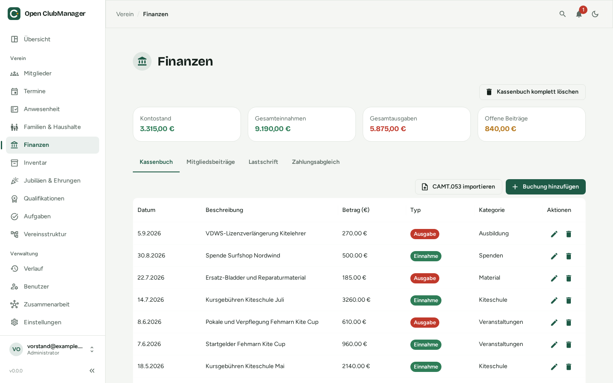
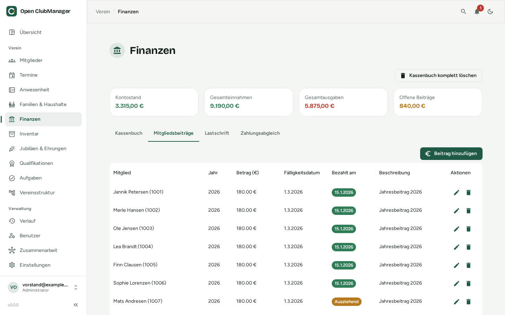
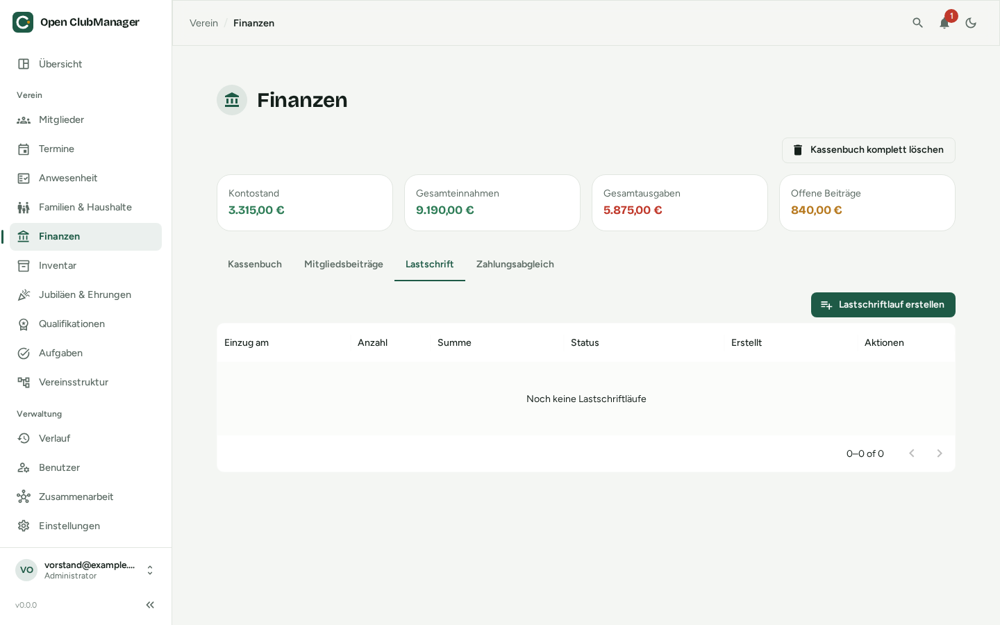
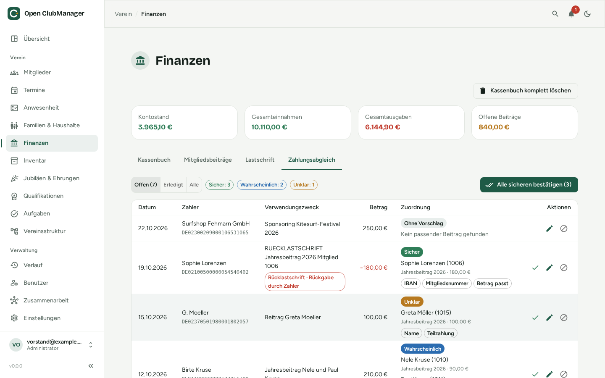

---
routes:
  - /finance
---

# Finanzen

Kassenbuch, Mitgliedsbeiträge, Beitragseinzug per SEPA-Lastschrift und Zahlungsabgleich mit dem Kontoauszug. Sichtbar nur für **Administratoren** und **Kassenwarte**.

{ .screenshot }

Oben siehst du den **Kontostand**, die **Gesamteinnahmen**, die **Gesamtausgaben** und die **offenen Beiträge**.

## Kassenbuch

Jede Einnahme und Ausgabe ist eine Buchung mit Datum, Beschreibung, Betrag, Typ (Einnahme/Ausgabe), Kategorie und Notizen.

- **Buchung hinzufügen** legt eine neue Buchung an.
- Über Stift und Papierkorb bearbeitest oder löschst du Buchungen.

Kosten aus der [Wartung im Inventar](inventar.md#prufung-wartung) können direkt als Ausgabe ins Kassenbuch gebucht werden.

### Kontoauszug importieren (CAMT.053)

Statt jede Buchung abzutippen, importierst du den Kontoauszug deiner Bank im Format **CAMT.053** (XML). Fast alle deutschen Banken bieten das im Online-Banking an, oft unter „Kontoauszug exportieren“ oder „Umsätze exportieren → CAMT“.

1. Klicke auf **CAMT.053 importieren** und wähle die Datei.
2. Open ClubManager legt für jede Kontobewegung eine Buchung an: Gutschriften als Einnahme, Lastschriften als Ausgabe. Name und IBAN des Zahlers sowie die Lastschrift-Referenzen werden für den [Zahlungsabgleich](#zahlungsabgleich) gemerkt.
3. Danach siehst du eine Zusammenfassung, wie viele Buchungen importiert wurden – und für wie viele es einen Vorschlag gibt, welchen offenen Beitrag sie bezahlen. **Zum Zahlungsabgleich** führt direkt zur Prüfung.

!!! warning "Derzeit noch zu beachten"
    Importiere jeden Kontoauszug **nur einmal**. Bereits importierte Bewegungen werden noch nicht erkannt und würden doppelt gebucht.

## Mitgliedsbeiträge

{ .screenshot }

Hier verwaltest du die Beiträge je Mitglied und Jahr: Betrag, Fälligkeitsdatum, Bezahlt-am-Datum und Beschreibung. Offene Beiträge sind als **Ausstehend** markiert.

Ein Beitrag gilt als bezahlt, sobald du das Bezahlt-am-Datum einträgst, ein [Lastschriftlauf](#lastschrift-sepa) bestätigt wird oder im [Zahlungsabgleich](#zahlungsabgleich) genug Zahlungen zugeordnet sind. Ein **teilweise bezahlter** Beitrag bleibt ausstehend, bis der Rest eingeht.

## Lastschrift (SEPA)

{ .screenshot }

Im Reiter **Lastschrift** ziehst du offene Beiträge per SEPA-Basislastschrift ein. Open ClubManager erstellt dafür eine Datei im Bankformat **pain.008**, die du im Online-Banking hochlädst. Der Reiter erscheint nur, wenn deine Rolle Finanzen bearbeiten darf und – bei der [Zusammenarbeit](../zusammenarbeit/index.md) – dein Gerät Bank- und Finanzdaten bekommt.

### Einmalig einrichten

1. In den [Einstellungen](einstellungen.md#sepa-lastschrift) unter **SEPA-Lastschrift** den Vereinsnamen, die **Gläubiger-ID** (von der Deutschen Bundesbank, z. B. `DE98ZZZ09999999999`), die **IBAN des Vereinskontos** und optional eine **Vorlage für den Verwendungszweck** hinterlegen.
2. Bei jedem Mitglied, das per Lastschrift zahlt, im [Mitglieder-Dialog](mitglieder.md#mitglied-anlegen-oder-bearbeiten) unter **Bankinformationen** IBAN, **SEPA Mandat Datum** und eine eindeutige **Mandatsreferenz** (z. B. `NW-1001`) eintragen.

### Lastschriftlauf erstellen

Klicke auf **Lastschriftlauf erstellen**. Ein Assistent führt in drei Schritten durch den Lauf:

1. **Beiträge auswählen:** Alle offenen Beiträge werden angezeigt – bei teilweise bezahlten Beiträgen mit dem Restbetrag. Beiträge, die sich nicht einziehen lassen (keine IBAN, kein Mandat, keine Mandatsreferenz, ungültige IBAN …), stehen unter **Nicht einziehbar** mit dem Grund – ergänze die Daten beim Mitglied.
2. **Fälligkeit & Verwendungszweck:** das **Fälligkeitsdatum (Einzug)**. Die Datei muss spätestens einen Bankarbeitstag vorher bei der Bank sein. Darunter siehst du eine Vorschau des Verwendungszwecks.
3. **Prüfen & exportieren:** Anzahl, Summe, Erst- (FRST) und Folgelastschriften (RCUR) prüfen und **Erstellen & herunterladen**.

Danach sind die Beiträge als **Im Einzug** markiert.

### Nach dem Export

| Schritt | Wo |
|---|---|
| Die `.xml`-Datei im Online-Banking hochladen und freigeben | bei deiner Bank |
| Wenn die Bank eingezogen hat: **Als bezahlt bestätigen** und das Datum angeben – alle Beiträge des Laufs werden als bezahlt markiert | Lastschriftlauf in der Liste |
| Rücklastschriften: Kontoauszug importieren und im Zahlungsabgleich bestätigen – der Beitrag ist wieder offen und kann erneut eingezogen werden | [Zahlungsabgleich](#rucklastschriften) |
| Lauf versehentlich erstellt? **Lauf stornieren** – die Beiträge sind wieder offen. Die Datei dann nicht mehr hochladen bzw. den Auftrag bei der Bank widerrufen | Lastschriftlauf in der Liste |

Mit **XML-Datei herunterladen** bekommst du die Datei eines Laufs erneut.

!!! info "Erst- und Folgelastschrift"
    Wird ein Mandat zum ersten Mal genutzt, markiert Open ClubManager die Lastschrift als Erstlastschrift (FRST), danach als Folgelastschrift (RCUR). Das passiert automatisch.

## Zahlungsabgleich

{ .screenshot }

Im Reiter **Zahlungsabgleich** ordnest du importierte Zahlungseingänge den offenen Beiträgen zu, statt jede Überweisung von Hand zu suchen. Open ClubManager schlägt für jede Buchung vor, welche Beiträge sie bezahlt – **gebucht wird erst, wenn du bestätigst**. Wie die [Lastschrift](#lastschrift-sepa) erscheint der Reiter nur, wenn deine Rolle Finanzen bearbeiten darf und dein Gerät Bank- und Finanzdaten bekommt.

### Wie Vorschläge entstehen

Für jeden Zahlungseingang werden geprüft:

- die **Mitgliedsnummer** im Verwendungszweck, z. B. „Beitrag 2026 Mitglied 1013“ oder „Mitgl.-Nr. 12“ (kurze Nummern nur mit einem Wort wie „Mitglied“, „Nr.“ oder „#“ davor),
- die **IBAN des Zahlers** im Vergleich mit den Bankdaten der Mitglieder,
- der **Name** des Zahlers und im Verwendungszweck, auch mit Umlauten („Möller“ = „Moeller“) und kleinen Tippfehlern,
- der **Betrag**: passt er zu einem offenen Beitrag, zu allen offenen Beiträgen des Mitglieds oder seines [Haushalts](haushalte.md)?

Daraus ergibt sich die **Trefferqualität**:

| Trefferqualität | Bedeutung |
|---|---|
| **Sicher** | Mitgliedsnummer oder IBAN erkannt und der Betrag passt genau |
| **Wahrscheinlich** | Mitgliedsnummer oder IBAN erkannt, aber der Betrag weicht ab (Teil- oder Überzahlung) – oder Name und Betrag passen |
| **Unklar** | Nur der Name passt, der Betrag nicht – bitte genau prüfen |
| **Ohne Vorschlag** | Kein passender offener Beitrag, z. B. bei Spenden oder Sponsoring |

Die Chips unter dem Vorschlag zeigen, woran er erkannt wurde (z. B. *Mitgliedsnummer*, *IBAN*, *Betrag passt*, *Haushalt*, *Teilzahlung*).

### Prüfen und bestätigen

- **Bestätigen** (Häkchen) übernimmt den Vorschlag. Der Beitrag bekommt das Buchungsdatum als Bezahlt-am-Datum.
- **Alle sicheren bestätigen** übernimmt auf einmal alle Vorschläge mit der Trefferqualität *Sicher*.
- **Zuordnung ändern** (Stift) öffnet eine Liste aller offenen Beiträge mit Suche. Hake die passenden Beiträge an und passe die Beträge an – so korrigierst du einen Vorschlag oder ordnest eine Buchung ohne Vorschlag selbst zu.
- **Ohne Beitrag abhaken** markiert eine Buchung als geprüft, wenn sie keinen Beitrag bezahlt (z. B. Spende). Sie verschwindet aus den offenen Buchungen.
- **Rückgängig** (unter **Erledigt**) nimmt eine Zuordnung zurück. Die Beiträge bekommen den Stand von vorher.

### Teilzahlungen und Sammelüberweisungen

- Zahlt ein Mitglied in **Raten**, ordnest du jede Rate demselben Beitrag zu. Der Beitrag bleibt *Ausstehend*, bis die Summe erreicht ist; eine Lastschrift zieht nur noch den Rest ein.
- Überweisen Eltern für **mehrere Kinder** auf einmal, verteilt der Vorschlag den Betrag auf die Beiträge des Haushalts. Im Dialog kannst du beliebig viele Beiträge – auch verschiedener Mitglieder – mit eigenen Beträgen auswählen.
- Bleibt bei einer Überzahlung ein Rest, wird er angezeigt und keinem Beitrag zugeordnet.

### Rücklastschriften

Eine zurückgegebene Lastschrift (Rücklastschrift) erkennt Open ClubManager beim Import am Bankcode bzw. am Rückgabegrund und zeigt sie rot mit dem Grund an, z. B. *Keine Deckung* oder *Rückgabe durch Zahler*. Der Vorschlag nennt den zuvor bezahlten Beitrag – bei Läufen aus Open ClubManager sicher über die Lastschrift-Referenz, sonst über IBAN, Mitgliedsnummer und Betrag.

Bestätigst du die Rücklastschrift, ist der Beitrag wieder **offen** und kann in einem neuen [Lastschriftlauf](#lastschrift-sepa) erneut eingezogen werden. Rückbuchungsgebühren der Bank bleiben als Rest ohne Beitrag stehen.

!!! tip "Ausprobieren mit den Beispieldaten"
    Wenn du bei der Einrichtung die Beispieldaten gewählt hast, kannst du den Abgleich mit der Beispieldatei [`testdata/camt053-reconciliation.xml`](https://github.com/Waschndolos/open-clubmanager/blob/main/testdata/camt053-reconciliation.xml) ausprobieren: Sie enthält sichere, wahrscheinliche und unklare Zahlungen, eine Familienüberweisung, eine Rücklastschrift und eine Sponsoring-Einnahme.

## Kassenbuch komplett löschen

Für einen Neuanfang (z. B. nach dem Ausprobieren mit Beispieldaten) kannst du alle Buchungen und Beiträge auf einmal löschen. Zur Sicherheit musst du dazu ein Bestätigungswort eintippen. **Das lässt sich nicht rückgängig machen** – erstelle vorher eine [Datensicherung](einstellungen.md#datensicherung).

!!! warning "Kein Ersatz für die Buchhaltung"
    Das Kassenbuch ist eine Hilfe für den Vereinsalltag. Es ersetzt keine steuerlich anerkannte Buchführung, keinen DATEV-Export und keine Beratung durch Steuerberater oder Kassenprüfer.
