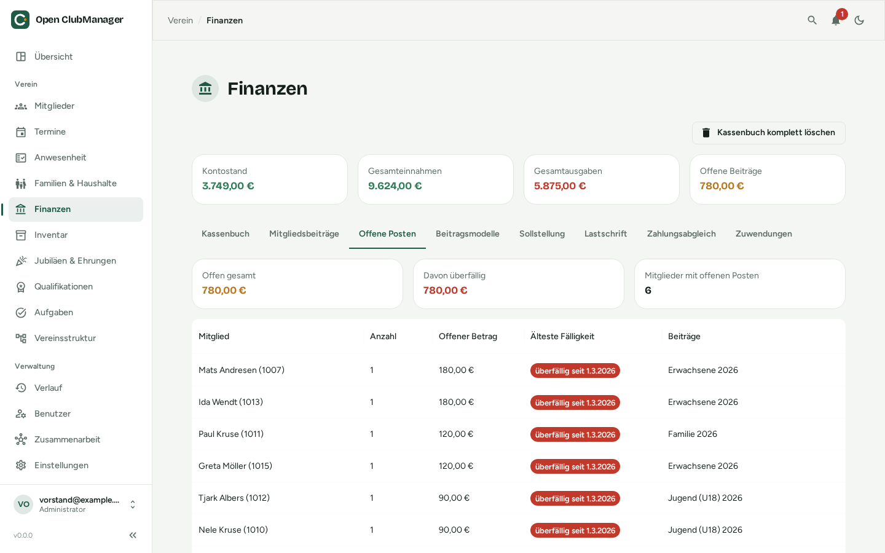
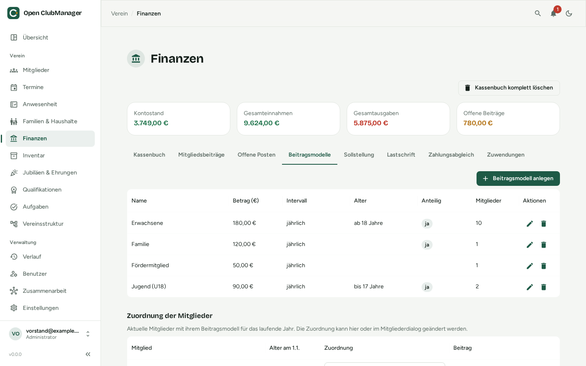
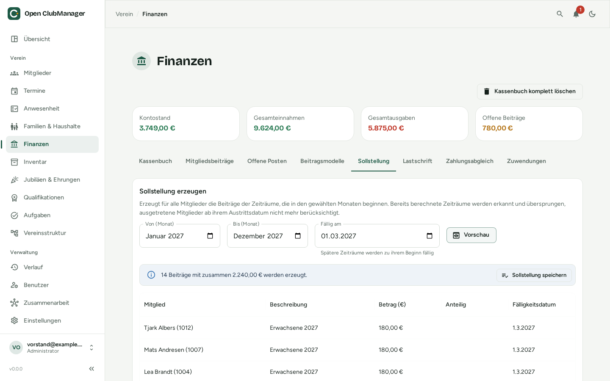
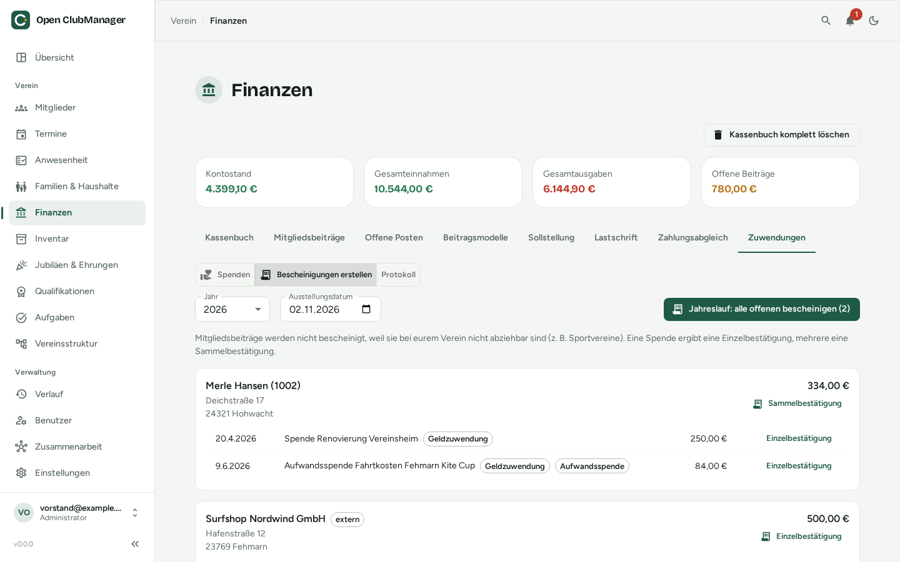

---
routes:
  - /finance
---

# Finanzen

Kassenbuch, Mitgliedsbeiträge, Beitragsmodelle mit automatischer Sollstellung, offene Posten, Beitragseinzug per SEPA-Lastschrift, Zahlungsabgleich mit dem Kontoauszug und Zuwendungsbestätigungen. Sichtbar nur für **Administratoren** und **Kassenwarte**.

{ .screenshot }

Oben siehst du den **Kontostand**, die **Gesamteinnahmen**, die **Gesamtausgaben** und die **offenen Beiträge**.

## Kassenbuch

Jede Einnahme und Ausgabe ist eine Buchung mit Datum, Beschreibung, Betrag, Typ (Einnahme/Ausgabe), Kategorie und Notizen.

- **Buchung hinzufügen** legt eine neue Buchung an.
- Über Stift und Papierkorb bearbeitest oder löschst du Buchungen.

Kosten aus der [Wartung im Inventar](inventar.md#prufung-wartung) können direkt als Ausgabe ins Kassenbuch gebucht werden.

### Kontoauszug importieren (CAMT.053)

Statt jede Buchung abzutippen, importierst du den Kontoauszug deiner Bank im Format **CAMT.053** (XML). Fast alle deutschen Banken bieten das im Online-Banking an, oft unter „Kontoauszug exportieren“ oder „Umsätze exportieren → CAMT“.

1. Klicke auf **CAMT.053 importieren** und wähle die Datei.
2. Open ClubManager legt für jede Kontobewegung eine Buchung an: Gutschriften als Einnahme, Lastschriften als Ausgabe. Name und IBAN des Zahlers sowie die Lastschrift-Referenzen werden für den [Zahlungsabgleich](#zahlungsabgleich) gemerkt.
3. Danach siehst du eine Zusammenfassung, wie viele Buchungen importiert wurden – und für wie viele es einen Vorschlag gibt, welchen offenen Beitrag sie bezahlen. **Zum Zahlungsabgleich** führt direkt zur Prüfung.

!!! warning "Derzeit noch zu beachten"
    Importiere jeden Kontoauszug **nur einmal**. Bereits importierte Bewegungen werden noch nicht erkannt und würden doppelt gebucht.

## Mitgliedsbeiträge

{ .screenshot }

Hier verwaltest du die Beiträge je Mitglied und Jahr: Betrag, Fälligkeitsdatum, Bezahlt-am-Datum und Beschreibung. Offene Beiträge sind als **Ausstehend** markiert.

Ein Beitrag gilt als bezahlt, sobald du das Bezahlt-am-Datum einträgst, ein [Lastschriftlauf](#lastschrift-sepa) bestätigt wird oder im [Zahlungsabgleich](#zahlungsabgleich) genug Zahlungen zugeordnet sind. Ein **teilweise bezahlter** Beitrag bleibt ausstehend, bis der Rest eingeht.

Einzelne Beiträge (z. B. eine Aufnahmegebühr) legst du mit **Beitrag hinzufügen** an. Die regelmäßigen Beiträge aller Mitglieder erzeugst du besser auf einmal über [Beitragsmodelle](#beitragsmodelle) und die [Sollstellung](#sollstellung).

## Offene Posten

{ .screenshot }

Der Reiter **Offene Posten** zeigt alle noch nicht bezahlten Beiträge, zusammengefasst je Mitglied: Anzahl, offener Betrag, älteste Fälligkeit und um welche Beiträge es geht. Oben stehen der **offene Gesamtbetrag**, wie viel davon **überfällig** ist und wie viele Mitglieder offene Posten haben. Überfällige Posten sind rot markiert. Mitglieder mit dem höchsten offenen Betrag stehen oben.

## Beitragsmodelle

{ .screenshot }

Ein Beitragsmodell ist eine Beitragsklasse deines Vereins, z. B. *Erwachsene*, *Jugend*, *Familie*, *Passiv* oder *Ermäßigt*. Lege sie im Reiter **Beitragsmodelle** mit **Beitragsmodell anlegen** an:

| Feld | Bedeutung |
|---|---|
| **Name** | Erscheint in der Beschreibung der erzeugten Beiträge, z. B. „Erwachsene 2027“. Muss eindeutig sein. |
| **Betrag** | Betrag **je Zeitraum** des Intervalls (bei *quartalsweise* also der Quartalsbeitrag). |
| **Intervall** | jährlich, halbjährlich, quartalsweise oder monatlich. Die Zeiträume richten sich nach dem Kalenderjahr (1. Halbjahr = Januar–Juni, 1. Quartal = Januar–März …). |
| **Mindestalter / Höchstalter** | Optional. Modelle mit Altersgrenze werden automatisch nach Alter vergeben (siehe unten). Beide Grenzen zählen mit: *Höchstalter 17* heißt „bis einschließlich 17 Jahre“. |
| **Anteilig** | Bei Ein- oder Austritt während eines Zeitraums nur die Monate der Mitgliedschaft berechnen (siehe [Anteilige Berechnung](#anteilige-berechnung)). |

Ändert sich ein Betrag, gilt der neue Betrag für alle künftigen Sollstellungen; bereits erzeugte Beiträge bleiben unverändert.

### Welches Mitglied zahlt welches Modell?

Unter **Zuordnung der Mitglieder** siehst du alle aktuellen Mitglieder mit ihrem Alter am 1. Januar und dem Beitrag, den sie im laufenden Jahr zahlen. Die Zuordnung änderst du direkt in der Liste oder im [Mitglieder-Dialog](mitglieder.md#mitglied-anlegen-oder-bearbeiten) unter **Mitgliedschaft → Beitragsmodell**:

- **Automatisch nach Alter** (Standard): Das Mitglied bekommt das Modell mit Altersgrenze, zu dem sein Alter passt. Passen mehrere, gewinnt das mit der engsten Altersspanne (z. B. *Studierende 18–27* vor *Erwachsene ab 18*).
- **Ein bestimmtes Modell**, z. B. *Familie* oder *Passiv*: gilt unabhängig vom Alter.
- **Beitragsfrei**, z. B. für Ehrenmitglieder: Das Mitglied bekommt keine Beiträge.

!!! info "Wechsel mit 18 Jahren"
    Maßgeblich ist das **Alter am 1. Januar des Beitragsjahres**. Wer im Juni 18 wird, zahlt in diesem Jahr noch den Jugendbeitrag und ab dem folgenden Jahr automatisch den Erwachsenenbeitrag. So gibt es beim Wechsel weder Lücken noch doppelte Beiträge – auch wenn die beiden Modelle unterschiedliche Intervalle haben.

Mitglieder ohne Geburtsdatum oder ohne passendes Modell sind gelb markiert und werden bei der Sollstellung übersprungen. Wird ein Modell gelöscht, erhalten seine Mitglieder ihr Modell wieder automatisch nach Alter.

## Sollstellung

{ .screenshot }

Die Sollstellung erzeugt die Beiträge aller Mitglieder für einen Zeitraum auf einmal – typischerweise zu Beginn des Jahres für das ganze Jahr.

1. Im Reiter **Sollstellung** den Zeitraum wählen: **Von (Monat)** und **Bis (Monat)**, z. B. Januar bis Dezember 2027. Berechnet werden alle Beitragszeiträume, die in diesen Monaten **beginnen**.
2. **Fällig am** festlegen, z. B. den 1. März. Zeiträume, die erst später beginnen (z. B. das 3. Quartal), werden zu ihrem Beginn fällig.
3. **Vorschau** klicken. Noch wird nichts gespeichert. Die Vorschau zeigt **Anzahl und Summe** der Beiträge, jeden einzelnen Beitrag mit Betrag und Fälligkeit und darunter, wer übersprungen wird und warum:
    - **bereits berechnet**: Für diesen Zeitraum hat das Mitglied schon einen Beitrag aus einer Sollstellung,
    - **ohne passendes Beitragsmodell**: z. B. fehlt das Geburtsdatum,
    - **beitragsfrei**.
4. Stimmt alles, **Sollstellung speichern**. Die Beiträge erscheinen unter [Mitgliedsbeiträge](#mitgliedsbeitrage) und [Offene Posten](#offene-posten) und lassen sich wie gewohnt per [Lastschrift](#lastschrift-sepa) einziehen.

Unter **Bisherige Sollstellungen** siehst du jede gespeicherte Sollstellung mit Anzahl, Summe und wie viele Beiträge schon bezahlt sind.

### Keine doppelten Beiträge

Open ClubManager merkt sich für jeden erzeugten Beitrag, für welchen Zeitraum er gilt. Ein Zeitraum, der für ein Mitglied schon berechnet wurde, wird **nie ein zweites Mal** berechnet:

- Startest du dieselbe Sollstellung noch einmal, zeigt die Vorschau „nichts zu berechnen“ und das Speichern wird abgelehnt.
- Überschneidet sich der Zeitraum mit einer früheren Sollstellung, werden nur die noch fehlenden Zeiträume berechnet. So kannst du die Sollstellung z. B. im Sommer wiederholen, um **neu eingetretene Mitglieder** nachzuberechnen.
- Löschst du einen erzeugten Beitrag, ist der Zeitraum wieder frei und kann erneut berechnet werden.

!!! warning "Von Hand angelegte Beiträge"
    Die Erkennung gilt nur für Beiträge aus einer Sollstellung. Hast du Beiträge eines Zeitraums schon von Hand mit **Beitrag hinzufügen** angelegt (z. B. den Jahresbeitrag vor dem Umstieg auf Beitragsmodelle), würden sie ein zweites Mal berechnet. Beginne die erste Sollstellung dann mit dem nächsten Zeitraum oder lösche die von Hand angelegten offenen Beiträge vorher.

Eine versehentliche Sollstellung nimmst du mit dem Papierkorb in der Liste **Bisherige Sollstellungen** zurück: Alle noch offenen Beiträge der Sollstellung werden gelöscht, bezahlte bleiben erhalten. Sind Beiträge in einem noch nicht bestätigten [Lastschriftlauf](#lastschrift-sepa), musst du den Lauf zuerst stornieren oder bestätigen.

### Eintritt und Austritt

- Wer **ausgetreten** ist, wird ab dem Austrittsdatum nicht mehr berücksichtigt: Für Zeiträume, die am oder nach dem Austrittsdatum beginnen, entsteht kein Beitrag. Am Austrittsdatum selbst ist das Mitglied kein Mitglied mehr.
- Wer erst nach dem Ende eines Zeitraums **eintritt**, bekommt für diesen Zeitraum keinen Beitrag.

### Anteilige Berechnung

Ohne die Option **Anteilig** wird für einen Zeitraum immer der volle Betrag fällig, sobald das Mitglied an mindestens einem Tag darin Mitglied ist. Mit **Anteilig** zählt jeder Monat des Zeitraums, in dem das Mitglied an mindestens einem Tag Mitglied ist; berechnet wird der entsprechende Anteil, auf den Cent gerundet.

| Beispiel (Jahresbeitrag 120 €, anteilig) | Monate | Beitrag |
|---|---|---|
| Eintritt am 1. oder 30. April | April–Dezember = 9 | 90,00 € |
| Austritt zum 1. Juli (letzter Tag: 30. Juni) | Januar–Juni = 6 | 60,00 € |
| Eintritt 15. März, Austritt 20. August | März–August = 6 | 60,00 € |

In der Vorschau sind anteilige Beiträge mit „anteilig von …“ gekennzeichnet.

## Lastschrift (SEPA)

{ .screenshot }

Im Reiter **Lastschrift** ziehst du offene Beiträge per SEPA-Basislastschrift ein. Open ClubManager erstellt dafür eine Datei im Bankformat **pain.008**, die du im Online-Banking hochlädst. Der Reiter erscheint nur, wenn deine Rolle Finanzen bearbeiten darf und – bei der [Zusammenarbeit](../zusammenarbeit/index.md) – dein Gerät Bank- und Finanzdaten bekommt.

### Einmalig einrichten

1. In den [Einstellungen](einstellungen.md#sepa-lastschrift) unter **SEPA-Lastschrift** den Vereinsnamen, die **Gläubiger-ID** (von der Deutschen Bundesbank, z. B. `DE98ZZZ09999999999`), die **IBAN des Vereinskontos** und optional eine **Vorlage für den Verwendungszweck** hinterlegen.
2. Bei jedem Mitglied, das per Lastschrift zahlt, im [Mitglieder-Dialog](mitglieder.md#mitglied-anlegen-oder-bearbeiten) unter **Bankinformationen** IBAN, **SEPA Mandat Datum** und eine eindeutige **Mandatsreferenz** (z. B. `NW-1001`) eintragen.

### Lastschriftlauf erstellen

Klicke auf **Lastschriftlauf erstellen**. Ein Assistent führt in drei Schritten durch den Lauf:

1. **Beiträge auswählen:** Alle offenen Beiträge werden angezeigt – bei teilweise bezahlten Beiträgen mit dem Restbetrag. Beiträge, die sich nicht einziehen lassen (keine IBAN, kein Mandat, keine Mandatsreferenz, ungültige IBAN …), stehen unter **Nicht einziehbar** mit dem Grund – ergänze die Daten beim Mitglied.
2. **Fälligkeit & Verwendungszweck:** das **Fälligkeitsdatum (Einzug)**. Die Datei muss spätestens einen Bankarbeitstag vorher bei der Bank sein. Darunter siehst du eine Vorschau des Verwendungszwecks.
3. **Prüfen & exportieren:** Anzahl, Summe, Erst- (FRST) und Folgelastschriften (RCUR) prüfen und **Erstellen & herunterladen**.

Danach sind die Beiträge als **Im Einzug** markiert.

### Nach dem Export

| Schritt | Wo |
|---|---|
| Die `.xml`-Datei im Online-Banking hochladen und freigeben | bei deiner Bank |
| Wenn die Bank eingezogen hat: **Als bezahlt bestätigen** und das Datum angeben – alle Beiträge des Laufs werden als bezahlt markiert | Lastschriftlauf in der Liste |
| Rücklastschriften: Kontoauszug importieren und im Zahlungsabgleich bestätigen – der Beitrag ist wieder offen und kann erneut eingezogen werden | [Zahlungsabgleich](#rucklastschriften) |
| Lauf versehentlich erstellt? **Lauf stornieren** – die Beiträge sind wieder offen. Die Datei dann nicht mehr hochladen bzw. den Auftrag bei der Bank widerrufen | Lastschriftlauf in der Liste |

Mit **XML-Datei herunterladen** bekommst du die Datei eines Laufs erneut.

!!! info "Erst- und Folgelastschrift"
    Wird ein Mandat zum ersten Mal genutzt, markiert Open ClubManager die Lastschrift als Erstlastschrift (FRST), danach als Folgelastschrift (RCUR). Das passiert automatisch.

## Zahlungsabgleich

{ .screenshot }

Im Reiter **Zahlungsabgleich** ordnest du importierte Zahlungseingänge den offenen Beiträgen zu, statt jede Überweisung von Hand zu suchen. Open ClubManager schlägt für jede Buchung vor, welche Beiträge sie bezahlt – **gebucht wird erst, wenn du bestätigst**. Wie die [Lastschrift](#lastschrift-sepa) erscheint der Reiter nur, wenn deine Rolle Finanzen bearbeiten darf und dein Gerät Bank- und Finanzdaten bekommt.

### Wie Vorschläge entstehen

Für jeden Zahlungseingang werden geprüft:

- die **Mitgliedsnummer** im Verwendungszweck, z. B. „Beitrag 2026 Mitglied 1013“ oder „Mitgl.-Nr. 12“ (kurze Nummern nur mit einem Wort wie „Mitglied“, „Nr.“ oder „#“ davor),
- die **IBAN des Zahlers** im Vergleich mit den Bankdaten der Mitglieder,
- der **Name** des Zahlers und im Verwendungszweck, auch mit Umlauten („Möller“ = „Moeller“) und kleinen Tippfehlern,
- der **Betrag**: passt er zu einem offenen Beitrag, zu allen offenen Beiträgen des Mitglieds oder seines [Haushalts](haushalte.md)?

Daraus ergibt sich die **Trefferqualität**:

| Trefferqualität | Bedeutung |
|---|---|
| **Sicher** | Mitgliedsnummer oder IBAN erkannt und der Betrag passt genau |
| **Wahrscheinlich** | Mitgliedsnummer oder IBAN erkannt, aber der Betrag weicht ab (Teil- oder Überzahlung) – oder Name und Betrag passen |
| **Unklar** | Nur der Name passt, der Betrag nicht – bitte genau prüfen |
| **Ohne Vorschlag** | Kein passender offener Beitrag, z. B. bei Spenden oder Sponsoring |

Die Chips unter dem Vorschlag zeigen, woran er erkannt wurde (z. B. *Mitgliedsnummer*, *IBAN*, *Betrag passt*, *Haushalt*, *Teilzahlung*).

### Prüfen und bestätigen

- **Bestätigen** (Häkchen) übernimmt den Vorschlag. Der Beitrag bekommt das Buchungsdatum als Bezahlt-am-Datum.
- **Alle sicheren bestätigen** übernimmt auf einmal alle Vorschläge mit der Trefferqualität *Sicher*.
- **Zuordnung ändern** (Stift) öffnet eine Liste aller offenen Beiträge mit Suche. Hake die passenden Beiträge an und passe die Beträge an – so korrigierst du einen Vorschlag oder ordnest eine Buchung ohne Vorschlag selbst zu.
- **Ohne Beitrag abhaken** markiert eine Buchung als geprüft, wenn sie keinen Beitrag bezahlt (z. B. Spende – die bescheinigst du unter [Zuwendungsbestätigungen](#zuwendungsbestatigungen)). Sie verschwindet aus den offenen Buchungen.
- **Rückgängig** (unter **Erledigt**) nimmt eine Zuordnung zurück. Die Beiträge bekommen den Stand von vorher.

### Teilzahlungen und Sammelüberweisungen

- Zahlt ein Mitglied in **Raten**, ordnest du jede Rate demselben Beitrag zu. Der Beitrag bleibt *Ausstehend*, bis die Summe erreicht ist; eine Lastschrift zieht nur noch den Rest ein.
- Überweisen Eltern für **mehrere Kinder** auf einmal, verteilt der Vorschlag den Betrag auf die Beiträge des Haushalts. Im Dialog kannst du beliebig viele Beiträge – auch verschiedener Mitglieder – mit eigenen Beträgen auswählen.
- Bleibt bei einer Überzahlung ein Rest, wird er angezeigt und keinem Beitrag zugeordnet.

### Rücklastschriften

Eine zurückgegebene Lastschrift (Rücklastschrift) erkennt Open ClubManager beim Import am Bankcode bzw. am Rückgabegrund und zeigt sie rot mit dem Grund an, z. B. *Keine Deckung* oder *Rückgabe durch Zahler*. Der Vorschlag nennt den zuvor bezahlten Beitrag – bei Läufen aus Open ClubManager sicher über die Lastschrift-Referenz, sonst über IBAN, Mitgliedsnummer und Betrag.

Bestätigst du die Rücklastschrift, ist der Beitrag wieder **offen** und kann in einem neuen [Lastschriftlauf](#lastschrift-sepa) erneut eingezogen werden. Rückbuchungsgebühren der Bank bleiben als Rest ohne Beitrag stehen.

!!! tip "Ausprobieren mit den Beispieldaten"
    Wenn du bei der Einrichtung die Beispieldaten gewählt hast, kannst du den Abgleich mit der Beispieldatei [`testdata/camt053-reconciliation.xml`](https://github.com/Waschndolos/open-clubmanager/blob/main/testdata/camt053-reconciliation.xml) ausprobieren: Sie enthält sichere, wahrscheinliche und unklare Zahlungen, eine Familienüberweisung, eine Rücklastschrift und eine Sponsoring-Einnahme.

## Zuwendungsbestätigungen

{ .screenshot }

Gemeinnützige Vereine dürfen für Spenden (und, je nach Zweck, Mitgliedsbeiträge) **Zuwendungsbestätigungen** ausstellen, mit denen Spender die Zuwendung von der Steuer absetzen. Open ClubManager erzeugt sie als PDF nach dem **amtlichen Muster** des Bundesfinanzministeriums – als Einzelbestätigung oder als Sammelbestätigung mit Anlage. Den Reiter **Zuwendungen** sehen Administratoren und Kassenwarte, wenn ihr Gerät die Finanzen und die Adressen der Mitglieder bekommt.

!!! warning "Der Verein haftet für richtige Bescheinigungen"
    Wer vorsätzlich oder grob fahrlässig eine falsche Zuwendungsbestätigung ausstellt, haftet für die entgangene Steuer (§ 10b Abs. 4 EStG). Prüfe deshalb vor dem Erstellen, ob Spender, Betrag und Datum stimmen. Im Zweifel hilft dein Steuerberater oder das Finanzamt.

### Einmalig einrichten

Trage in den [Einstellungen](einstellungen.md#zuwendungsbestatigungen) die Daten aus deinem Bescheid des Finanzamts ein: Name und Anschrift des Vereins, Finanzamt, Steuernummer, Art und Datum des Bescheids und die **begünstigten Zwecke** genau wie im Bescheid (z. B. „des Sports (§ 52 Abs. 2 Satz 1 Nr. 21 AO)“).

| Art des Bescheids | Gültig für Bescheinigungen |
|---|---|
| **Freistellungsbescheid** bzw. Anlage zum Körperschaftsteuerbescheid | 5 Jahre ab Datum des Bescheids |
| **Feststellungsbescheid nach § 60a AO** (z. B. bei einem neu gegründeten Verein) | 3 Jahre ab Datum des Bescheids |

Ist der Bescheid älter, erkennt das Finanzamt die Bescheinigungen nicht mehr an (§ 63 Abs. 5 AO). Open ClubManager zeigt dann in den Einstellungen und im Reiter eine **Warnung** mit dem Datum, bis zu dem der Bescheid reichte.

!!! info "Mitgliedsbeiträge"
    Bei Sportvereinen und Vereinen mit Freizeitzwecken (z. B. Kultur mit Freizeitcharakter, Heimatpflege, Kleingärten) sind Mitgliedsbeiträge **nicht** absetzbar (§ 10b Abs. 1 Satz 8 EStG). Lass dann den Schalter *Mitgliedsbeiträge sind steuerlich abziehbar* aus: Es werden nur Spenden bescheinigt, und die Bescheinigung bestätigt, dass es sich nicht um einen Mitgliedsbeitrag handelt. Ist der Schalter an, erscheinen auch die bezahlten Beiträge des Jahres.

### Spenden erfassen

Eine Spende ist eine **Einnahme im Kassenbuch** mit der Kategorie **Spende** (oder „Spenden“). Unter **Zuwendungen → Spenden** siehst du alle solchen Einnahmen.

1. Klicke bei einer Spende auf den Stift und wähle das **Mitglied** oder einen **externen Spender**. Externe Spender (z. B. Firmen) legst du darunter unter **Externe Spender** oder direkt im Dialog an.
2. Hake **Verzicht auf Erstattung von Aufwendungen** an, wenn es eine *Aufwandsspende* ist, also jemand auf die Erstattung von Fahrtkosten o. Ä. verzichtet.
3. Hat eine Einnahme noch keine Kategorie, bekommt sie beim Zuordnen die Kategorie „Spende“.

Für eine Bescheinigung braucht der Spender eine vollständige **Adresse** (Straße, PLZ und Ort). Bei Mitgliedern kommt sie aus den Kontaktdaten.

### Bescheinigungen erstellen

Unter **Zuwendungen → Bescheinigungen erstellen** wählst du das **Jahr** und das **Ausstellungsdatum**. Die Liste zeigt jeden Spender mit seinen Zuwendungen des Jahres; schon bescheinigte sind mit ihrer Nummer markiert.

- **Einzelbestätigung** bescheinigt genau eine Zuwendung.
- **Sammelbestätigung** fasst alle noch offenen Zuwendungen eines Spenders im Jahr zusammen. Die Anlage listet jede Zuwendung mit Datum, Art und Betrag.
- **Jahreslauf** erstellt auf einmal für alle Spender des Jahres die fehlenden Bescheinigungen – eine Sammelbestätigung bei mehreren Zuwendungen, sonst eine Einzelbestätigung. Spender ohne vollständige Adresse werden übersprungen und genannt.

Die PDFs werden sofort heruntergeladen (beim Jahreslauf alle in einer Datei, jede Bescheinigung beginnt auf einer neuen Seite). Drucke sie aus und unterschreibe sie.

### Nummerierung, Protokoll und Duplikate

Jede Bescheinigung bekommt eine **fortlaufende Nummer** pro Jahr, z. B. `2026-0001`. Unter **Zuwendungen → Protokoll** siehst du, welche Bescheinigung wann, für wen und von wem erstellt wurde.

- Eine Zuwendung kann nur **einmal** bescheinigt werden. Erstellst du für dieselben Zuwendungen erneut eine Bescheinigung – oder klickst im Protokoll auf **Duplikat erstellen** –, entsteht ein **Duplikat** mit derselben Nummer, das im PDF deutlich als *DUPLIKAT* gekennzeichnet ist und ebenfalls protokolliert wird.
- War eine Bescheinigung falsch (z. B. falscher Betrag), **storniere** sie mit einem Grund. Sie bleibt im Protokoll und ist im PDF als *storniert* markiert; ihre Zuwendungen kannst du danach neu bescheinigen. Eine bescheinigte Spende lässt sich erst nach dem Stornieren einem anderen Spender zuordnen.

## Kassenbuch komplett löschen

Für einen Neuanfang (z. B. nach dem Ausprobieren mit Beispieldaten) kannst du alle Buchungen, Beiträge und Sollstellungen auf einmal löschen; die Beitragsmodelle und die Zuordnung der Mitglieder bleiben erhalten. Zur Sicherheit musst du dazu ein Bestätigungswort eintippen. **Das lässt sich nicht rückgängig machen** – erstelle vorher eine [Datensicherung](einstellungen.md#datensicherung).

!!! warning "Kein Ersatz für die Buchhaltung"
    Das Kassenbuch ist eine Hilfe für den Vereinsalltag. Es ersetzt keine steuerlich anerkannte Buchführung, keinen DATEV-Export und keine Beratung durch Steuerberater oder Kassenprüfer.
