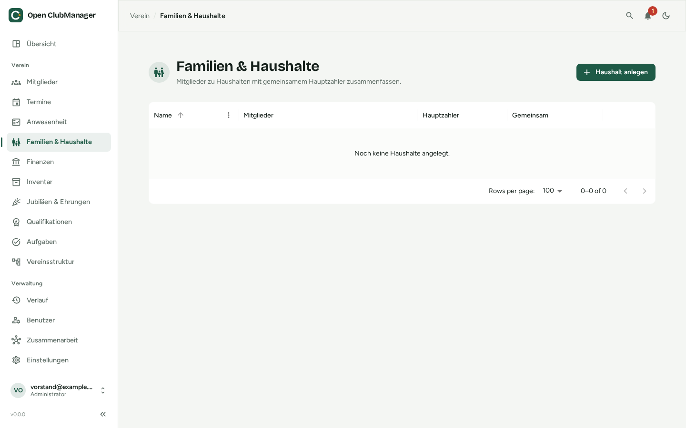

---
routes:
  - /households
---

# Families & households

Group members who live together or pay together into a household, typically for family memberships.

{ .screenshot }

## Adding a household

1. Click **Add household**.
2. Enter a name, e.g. "Miller family".
3. Select the members. A member can only belong to **one** household.
4. Choose the **main payer**. They pay the fees for the whole household (e.g. by direct debit).
5. Optional: **Shared address** and/or **Shared bank details**. The main payer's details are then used for all members of the household. If one member's address changes, it changes for all.

Deleting a household keeps its members.

## When the main payer leaves

If the main payer leaves the club, Open ClubManager warns you that the remaining members would have no main payer. Choose a new main payer in the household. Households without an active main payer also appear as a notice on the [overview](dashboard.md).

## Guardians

In the member dialog under **Family & guardians** you record the guardians of minors:

- **Club member**: a guardian who is a member themselves
- **Other person**: with name and relationship (e.g. "mother")

If a member is a minor and has no guardians, Open ClubManager points this out.
