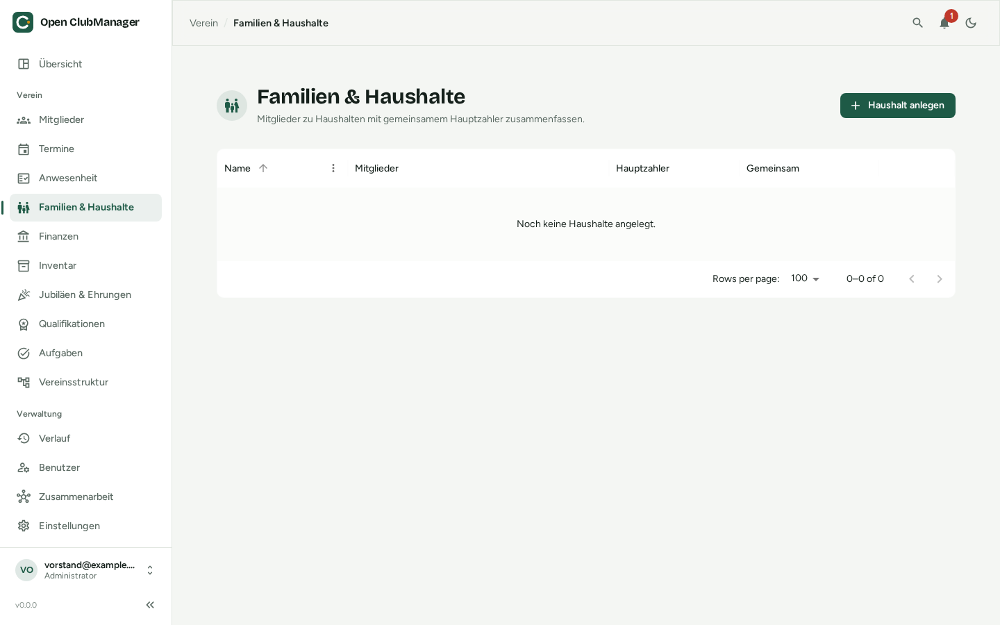

---
routes:
  - /households
---

# Familien & Haushalte

Fasse Mitglieder, die zusammen wohnen oder gemeinsam bezahlen, zu einem Haushalt zusammen – typisch für Familienmitgliedschaften.

{ .screenshot }

## Haushalt anlegen

1. Klicke auf **Haushalt anlegen**.
2. Gib einen Namen ein, z. B. „Familie Müller“.
3. Wähle die Mitglieder aus. Ein Mitglied kann nur zu **einem** Haushalt gehören.
4. Bestimme den **Hauptzahler**. Er zahlt die Beiträge für den ganzen Haushalt (z. B. per Lastschrift).
5. Optional: **Gemeinsame Adresse** und/oder **Gemeinsame Bankverbindung**. Dann werden die Daten des Hauptzahlers für alle Mitglieder des Haushalts übernommen. Ändert sich die Adresse eines Mitglieds, gilt das für alle.

Wird ein Haushalt gelöscht, bleiben die Mitglieder erhalten.

## Wenn der Hauptzahler austritt

Tritt der Hauptzahler aus dem Verein aus, warnt Open ClubManager: Die übrigen Mitglieder hätten dann keinen Hauptzahler mehr. Bestimme im Haushalt einen neuen Hauptzahler. Haushalte ohne aktiven Hauptzahler erscheinen auch als Hinweis auf der [Übersicht](dashboard.md).

## Erziehungsberechtigte

Im Mitglieder-Dialog unter **Familie & Erziehungsberechtigte** hinterlegst du für Minderjährige ihre Erziehungsberechtigten:

- **Vereinsmitglied** – eine erziehungsberechtigte Person, die selbst Mitglied ist
- **Andere Person** – mit Name und Beziehung (z. B. „Mutter“)

Ist ein Mitglied minderjährig und ohne Erziehungsberechtigte, weist Open ClubManager darauf hin.
