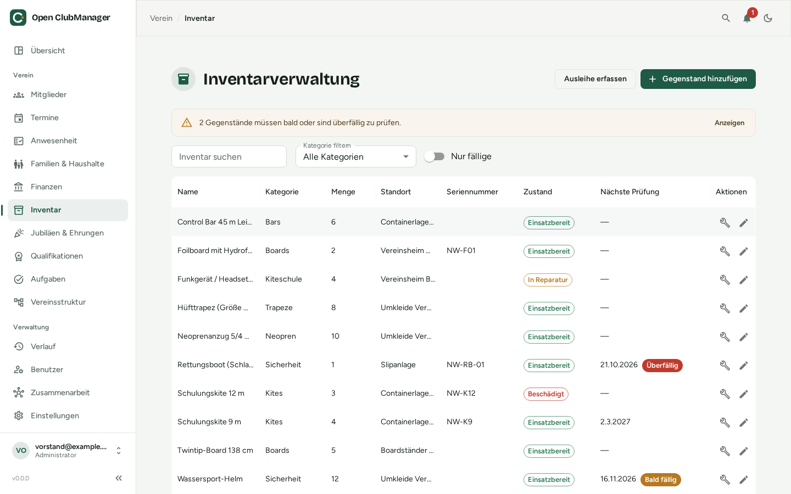

---
routes:
  - /inventory
---

# Inventory

Keep track of the club's equipment: what you have, where it is, who borrowed it and when it needs an inspection.

{ .screenshot }

## Items

**Add item** records name, description, serial number, category, quantity, location, purchase date and purchase price.

The search field and the **category filter** help you find items quickly. **Only due** shows only items whose inspection is due soon or overdue.

## Loans

1. Click **Create loan**.
2. Choose the item and the member, the loan date and optionally a due date.
3. On return: **Mark as returned**.

At the top you see all **currently loaned items**. Only items in condition **Ready** can be lent out.

## Inspection & maintenance

For equipment that must be inspected regularly (life jackets, climbing ropes, first-aid kits, sports equipment), open **Inspection & maintenance** on the item:

- **Condition:** Ready, Damaged, In repair or Retired
- **Interval (months):** how often it must be inspected
- **Next inspection:** moves forward by the interval automatically after each recorded inspection

**Record inspection / maintenance** documents the date, who did it, cost, a note and the condition afterwards. Tick the box to book the cost directly as an **expense in the cash book**.

In the list, a badge shows the inspection status: **On schedule**, **Due soon** or **Overdue**. Due inspections also appear on the [overview](dashboard.md).

The **maintenance history** lists all past inspections, useful as evidence for insurers, for example.
