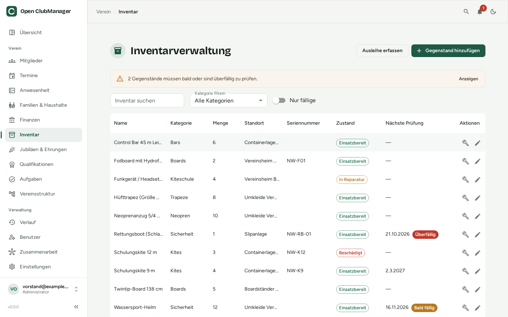

---
routes:
  - /inventory
---

# Inventar

Behalte den Überblick über das Material des Vereins: was ihr habt, wo es ist, wer es ausgeliehen hat und wann es geprüft werden muss.

{ .screenshot }

## Gegenstände

Mit **Gegenstand hinzufügen** erfasst du Name, Beschreibung, Seriennummer, Kategorie, Menge, Standort, Kaufdatum und Kaufpreis.

Über das Suchfeld und den **Kategorie-Filter** findest du Gegenstände schnell wieder. **Nur fällige** zeigt nur Gegenstände, deren Prüfung bald fällig oder überfällig ist.

## Ausleihen

1. Klicke auf **Ausleihe erfassen**.
2. Wähle Gegenstand und Mitglied, das Ausleihdatum und optional ein Rückgabedatum.
3. Bei Rückgabe: **Als zurückgegeben markieren**.

Oben siehst du alle **aktuell ausgeliehenen Gegenstände**. Nur Gegenstände im Zustand **Einsatzbereit** können ausgeliehen werden.

## Prüfung & Wartung

Für Material, das regelmäßig geprüft werden muss (Rettungswesten, Kletterseile, Erste-Hilfe-Kasten, Sportgeräte), öffnest du beim Gegenstand **Prüfung & Wartung**:

- **Zustand:** Einsatzbereit, Beschädigt, In Reparatur oder Ausgemustert
- **Intervall (Monate):** wie oft geprüft werden muss
- **Nächste Prüfung:** wird nach jeder erfassten Prüfung automatisch um das Intervall verschoben

Mit **Prüfung / Wartung erfassen** dokumentierst du Datum, wer geprüft hat, Kosten, Notiz und den Zustand danach. Die Kosten kannst du mit einem Häkchen direkt als **Ausgabe im Kassenbuch** buchen.

In der Liste zeigt eine Markierung den Prüfstatus: **Im Plan**, **Bald fällig** oder **Überfällig**. Fällige Prüfungen erscheinen auch auf der [Übersicht](dashboard.md).

Die **Wartungshistorie** zeigt alle bisherigen Prüfungen – nützlich als Nachweis, z. B. gegenüber Versicherungen.
