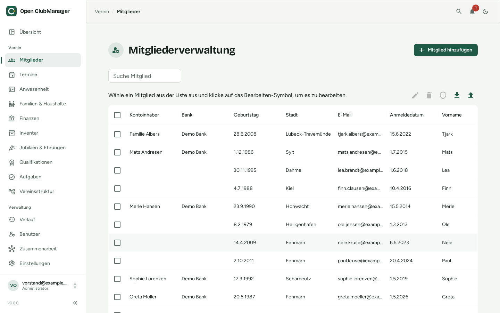
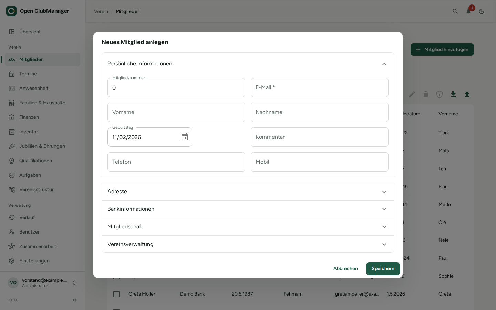

---
routes:
  - /members
---

# Members

Member management is the heart of Open ClubManager.

{ .screenshot }

## Member list

The table shows all members. The search field finds members by name, email or membership number. Use the column headers to sort and filter; hide columns you don't need (e.g. IBAN) via the column menu.

Above the table are the actions for the selected members:

| Icon | Action |
|---|---|
| :material-pencil: | Edit the selected member |
| :material-delete: | Delete the selected members |
| :material-shield-outline: | Create a [data export](#data-export-gdpr) for the selected member |
| :material-download: | Export the member list as an Excel file |
| :material-upload: | Import members from an Excel file |

## Adding or editing a member

Click **Add Member**, or select a member and click the pencil icon.

{ .screenshot }

The details are grouped into collapsible sections:

| Section | Content |
|---|---|
| **Personal Information** | membership number, email (required), first and last name, birthday, phone, mobile, comment |
| **Address** | street, postal code, city, state |
| **Bank Details** | account holder, IBAN, BIC, bank, date of the SEPA mandate, mandate reference (for [direct debit](finanzen.md#direct-debit-sepa), up to 35 characters without spaces, unique) |
| **Membership** | entry and exit date; for existing members the [fee model](finanzen.md#which-member-pays-which-model) (automatic by age, a specific model or exempt; only administrators and treasurers may change it) |
| **Club Entities** | assignment to [sections, groups and roles](vereinsstruktur.md) |
| **Family & guardians** | [household](haushalte.md) and guardians (for minors) |

!!! info "Membership numbers"
    Membership numbers and email addresses must be unique. With [collaboration](../zusammenarbeit/index.md), two people may assign the same number at the same time; this then shows up under [Needs attention](../zusammenarbeit/konflikte.md).

## Leaving and deleting members

- **Leaving the club:** enter an exit date. The member is kept and counts as an exit in the statistics.
- **Deleting:** removes the member completely. Use this when the data no longer has to be kept (data protection: don't store data longer than necessary).

## Excel import

The import brings in existing member lists. Described in detail under [Switching from Excel](../migration/von-excel.md).

1. **Select the Excel file** (`.xlsx`).
2. **Assign columns:** map each column of your file to a field in Open ClubManager or choose "Ignore". Choose whether existing members are recognised and updated by **email** or **membership number**.
3. **Check the preview:** duplicate values are highlighted. Then import.

## Excel export

Exports the member list as `memberlist.xlsx`, e.g. for mail merges or as a list for the annual general meeting.

!!! warning "Exported files are not protected"
    An exported Excel file contains personal data and is no longer protected by Open ClubManager. Only pass it on when necessary, and delete it when you no longer need it.

## Data export (GDPR)

Every member has the right to know what data the club stores about them (Art. 15 GDPR) and to receive it in a machine-readable format (Art. 20 GDPR).

Select the member and click the shield icon → **Create data export**:

- **Readable report (PDF)**: to print or send to the member
- **Machine-readable data (JSON)**: for data portability

More under [Data protection](../datenschutz.md).
