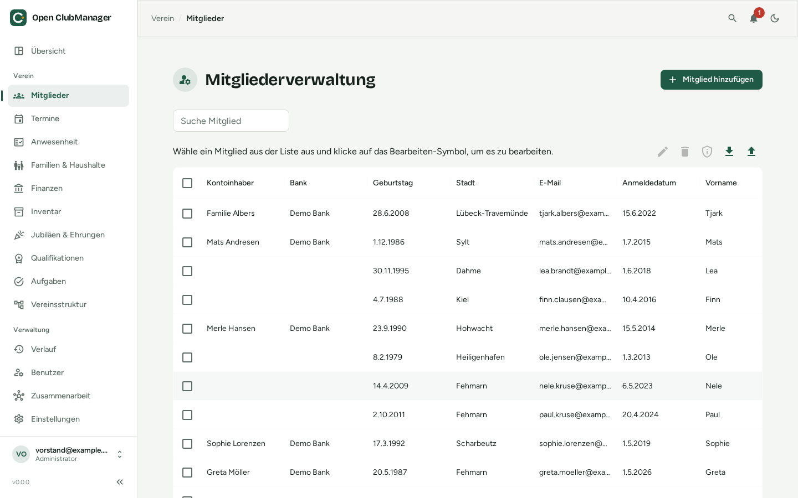
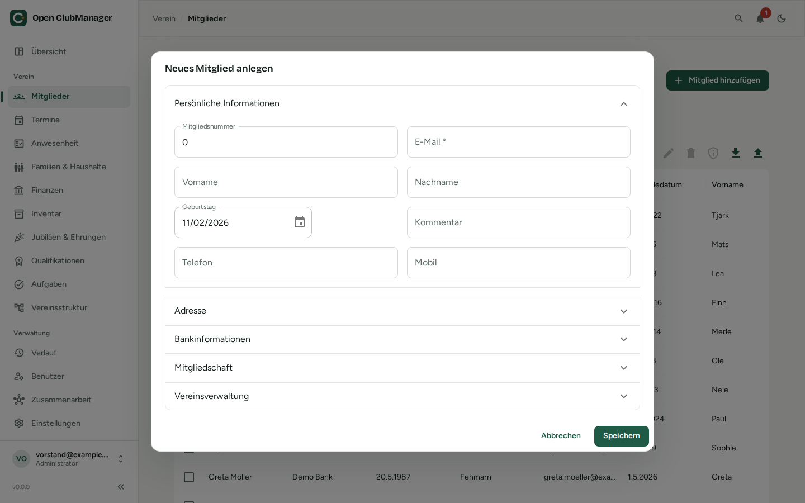

---
routes:
  - /members
---

# Mitglieder

Die Mitgliederverwaltung ist das Herzstück von Open ClubManager.

{ .screenshot }

## Mitgliederliste

Die Tabelle zeigt alle Mitglieder. Über das Suchfeld findest du Mitglieder nach Name, E-Mail oder Mitgliedsnummer. Über die Spaltenköpfe sortierst und filterst du; nicht benötigte Spalten (z. B. IBAN) blendest du über das Spaltenmenü aus.

Über der Tabelle findest du die Aktionen für die ausgewählten Mitglieder:

| Symbol | Aktion |
|---|---|
| :material-pencil: | Ausgewähltes Mitglied bearbeiten |
| :material-delete: | Ausgewählte Mitglieder löschen |
| :material-shield-outline: | [Datenauskunft](#datenauskunft-dsgvo) für das ausgewählte Mitglied erstellen |
| :material-download: | Mitgliederliste als Excel-Datei exportieren |
| :material-upload: | Mitglieder aus einer Excel-Datei importieren |

## Mitglied anlegen oder bearbeiten

Klicke auf **Mitglied hinzufügen** oder wähle ein Mitglied aus und klicke auf das Stift-Symbol.

{ .screenshot }

Die Angaben sind in aufklappbare Abschnitte gegliedert:

| Abschnitt | Inhalt |
|---|---|
| **Persönliche Informationen** | Mitgliedsnummer, E-Mail (Pflichtfeld), Vor- und Nachname, Geburtstag, Telefon, Mobil, Kommentar |
| **Adresse** | Straße, PLZ, Stadt, Bundesland |
| **Bankinformationen** | Kontoinhaber, IBAN, BIC, Bank, Datum des SEPA-Mandats, Mandatsreferenz (für die [Lastschrift](finanzen.md#lastschrift-sepa), bis 35 Zeichen ohne Leerzeichen, eindeutig) |
| **Mitgliedschaft** | Eintritts- und Austrittsdatum |
| **Vereinsverwaltung** | Zuordnung zu [Abteilungen, Gruppen und Rollen](vereinsstruktur.md) |
| **Familie & Erziehungsberechtigte** | [Haushalt](haushalte.md) und Erziehungsberechtigte (bei Minderjährigen) |

!!! info "Mitgliedsnummern"
    Mitgliedsnummern und E-Mail-Adressen müssen eindeutig sein. Bei der [Zusammenarbeit](../zusammenarbeit/index.md) kann es passieren, dass zwei Personen gleichzeitig dieselbe Nummer vergeben – das wird dann unter [Klärungsbedarf](../zusammenarbeit/konflikte.md) angezeigt.

## Mitglieder löschen und austreten lassen

- **Austritt:** Trage ein Austrittsdatum ein. Das Mitglied bleibt erhalten und zählt in den Statistiken als Austritt.
- **Löschen:** Entfernt das Mitglied vollständig. Nutze das, wenn die Daten nicht mehr aufbewahrt werden müssen (Datenschutz: Daten nicht länger als nötig speichern).

## Excel-Import

Mit dem Import übernimmst du vorhandene Mitgliederlisten. Ausführlich beschrieben unter [Von Excel umsteigen](../migration/von-excel.md).

1. **Excel-Datei auswählen** (`.xlsx`).
2. **Spalten zuordnen:** Ordne jeder Spalte deiner Datei ein Feld in Open ClubManager zu oder wähle „Ignorieren“. Lege fest, ob bestehende Mitglieder über **E-Mail** oder **Mitgliedsnummer** erkannt und aktualisiert werden.
3. **Vorschau prüfen:** Doppelte Werte werden markiert. Danach importieren.

## Excel-Export

Exportiert die Mitgliederliste als `memberlist.xlsx`, z. B. für Serienbriefe oder als Liste für die Jahreshauptversammlung.

!!! warning "Exportierte Dateien sind nicht geschützt"
    Eine exportierte Excel-Datei enthält personenbezogene Daten und unterliegt nicht mehr dem Schutz von Open ClubManager. Gib sie nur weiter, wenn nötig, und lösche sie, wenn du sie nicht mehr brauchst.

## Datenauskunft (DSGVO)

Jedes Mitglied hat das Recht zu erfahren, welche Daten der Verein über es speichert (Art. 15 DSGVO), und sie in einem maschinenlesbaren Format zu bekommen (Art. 20 DSGVO).

Wähle das Mitglied aus und klicke auf das Schild-Symbol → **Datenauskunft erstellen**:

- **Lesbarer Bericht (PDF)** – zum Ausdrucken oder Verschicken an das Mitglied
- **Maschinenlesbare Daten (JSON)** – für die Datenübertragbarkeit

Mehr unter [Datenschutz](../datenschutz.md).
