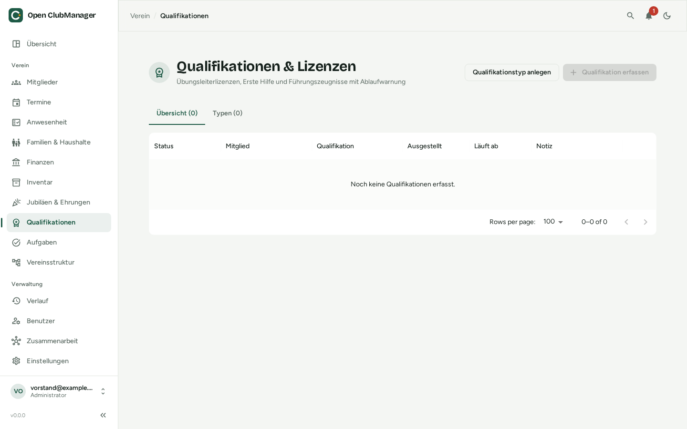

---
routes:
  - /qualifications
---

# Qualifications & licences

Coaching licences, first-aid courses, trainer certificates and police clearance certificates, with a warning before anything expires. Only visible to **administrators** and **secretaries**.

{ .screenshot }

## Adding types

In the **Types** tab, first define which qualifications your club tracks, for example:

| Type | Validity |
|---|---|
| Coaching licence level C | 48 months |
| First-aid course | 24 months |
| Enhanced police clearance certificate | 60 months, *inspection date only* |
| Boat licence | empty (unlimited) |

If the validity is left empty, the qualification does not expire.

## Recording a qualification

Click **Record qualification**, choose the member and type and enter the issue date. The expiry date is calculated from the validity; you can override it.

The **status** shows **Valid**, **Expires soon** or **Expired**. Qualifications that expire soon also appear on the [overview](dashboard.md).

## Police clearance certificates (§ 72a SGB VIII)

In Germany, clubs working with children and young people must inspect enhanced police clearance certificates but may not store their content. So enable **Store inspection date only** for that type. Then only the fact **that** and **when** the certificate was inspected is recorded. Notes are disabled for this type.
