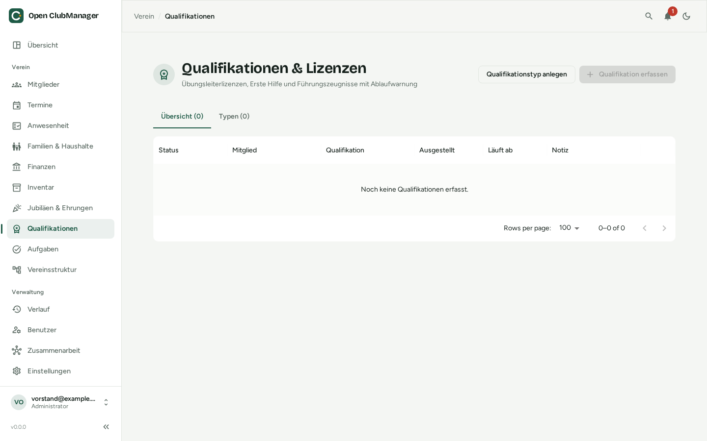

---
routes:
  - /qualifications
---

# Qualifikationen & Lizenzen

Übungsleiterlizenzen, Erste-Hilfe-Kurse, Trainerscheine und Führungszeugnisse – mit Warnung, bevor etwas abläuft. Sichtbar nur für **Administratoren** und **Schriftführer**.

{ .screenshot }

## Typen anlegen

Lege im Reiter **Typen** zuerst fest, welche Qualifikationen dein Verein erfasst, z. B.:

| Typ | Gültigkeit |
|---|---|
| Übungsleiter-C-Lizenz | 48 Monate |
| Erste-Hilfe-Kurs | 24 Monate |
| Erweitertes Führungszeugnis | 60 Monate, *nur Einsichtsdatum* |
| Bootsführerschein | leer (unbegrenzt) |

Bleibt die Gültigkeit leer, läuft die Qualifikation nicht ab.

## Qualifikation erfassen

Klicke auf **Qualifikation erfassen**, wähle Mitglied und Typ und gib das Ausstellungsdatum ein. Das Ablaufdatum wird aus der Gültigkeit berechnet; du kannst es überschreiben.

Der **Status** zeigt: **Gültig**, **Läuft bald ab** oder **Abgelaufen**. Bald ablaufende Qualifikationen erscheinen auch auf der [Übersicht](dashboard.md).

## Führungszeugnisse (§ 72a SGB VIII)

Vereine in der Kinder- und Jugendarbeit müssen erweiterte Führungszeugnisse einsehen, dürfen aber den Inhalt nicht speichern. Aktiviere beim Typ deshalb **Nur Einsichtsdatum speichern**. Dann wird nur festgehalten, **dass** und **wann** das Führungszeugnis eingesehen wurde. Notizen sind für diesen Typ abgeschaltet.
