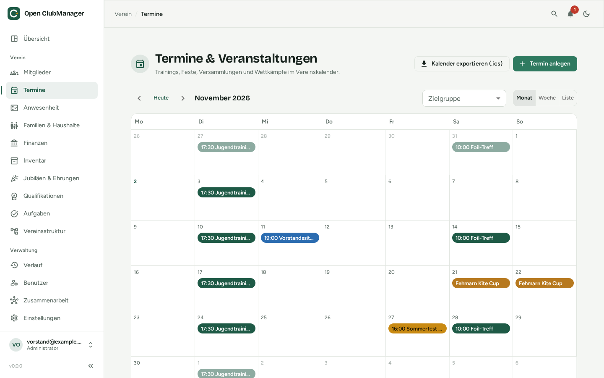
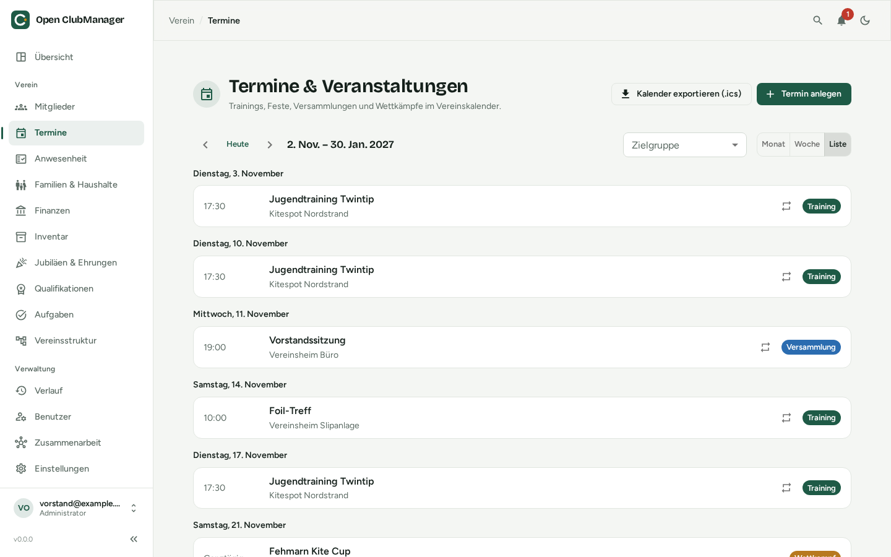

---
routes:
  - /events
---

# Events

The club calendar for training sessions, festivals, meetings and competitions.

{ .screenshot }

## Views

At the top right, switch between **Month**, **Week** and **List**. The arrows page through time, **Today** jumps back to the current date. **Audience** shows only events of certain groups, sections or roles.

{ .screenshot }

## Adding an event

Click **Add event** and fill in:

| Field | Note |
|---|---|
| **Title** and **category** | Training, Festival, Meeting, Competition or Other; the category sets the colour in the calendar |
| **All day** | for multi-day events such as tournaments or camps |
| **Start** / **End** | |
| **Recurrence** | never, weekly, every 2 weeks or monthly; with **Repeat until** (empty = no end) |
| **Location** and **description** | |
| **Groups, sections, roles** | the audience; without a selection the event is for the whole club |

The audience also decides who is expected as a participant in [attendance](anwesenheit.md).

## Editing recurring events

For recurring events you can choose:

- **Edit series**: changes all events of the series
- **Remove only this date**: skips a single date (e.g. no training during school holidays)
- **Delete series**: removes the whole series

## Exporting the calendar

- **Export calendar (.ics)** exports all events, for importing into Outlook, Google Calendar, Apple Calendar or Thunderbird.
- For a single event, **Download .ics** downloads only that event, e.g. to email it to members.

!!! note
    The export is a snapshot. A subscribable online calendar isn't possible because Open ClubManager is not a web application.
