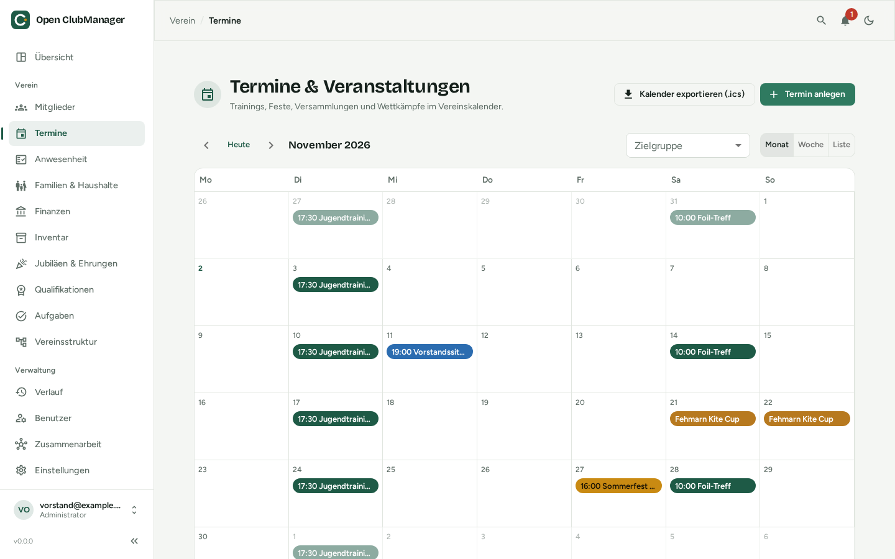
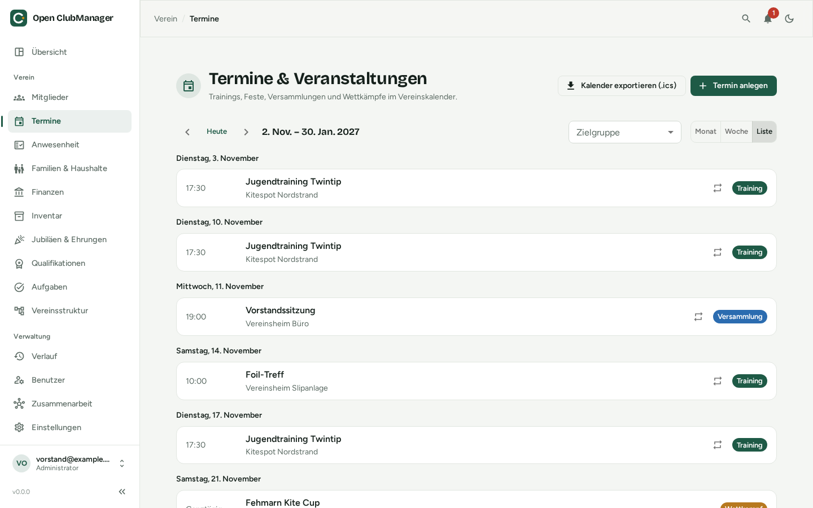

---
routes:
  - /events
---

# Termine & Veranstaltungen

Der Vereinskalender für Trainings, Feste, Versammlungen und Wettkämpfe.

{ .screenshot }

## Ansichten

Rechts oben wechselst du zwischen **Monat**, **Woche** und **Liste**. Mit den Pfeilen blätterst du, **Heute** springt zurück zum aktuellen Datum. Über **Zielgruppe** zeigst du nur Termine bestimmter Gruppen, Abteilungen oder Rollen.

{ .screenshot }

## Termin anlegen

Klicke auf **Termin anlegen** und fülle aus:

| Feld | Hinweis |
|---|---|
| **Titel** und **Kategorie** | Training, Fest, Versammlung, Wettkampf oder Sonstiges – die Kategorie bestimmt die Farbe im Kalender |
| **Ganztägig** | für mehrtägige Veranstaltungen wie Turniere oder Freizeiten |
| **Beginn** / **Ende** | |
| **Wiederholung** | keine, wöchentlich, alle 14 Tage oder monatlich; mit **Wiederholen bis** (leer = ohne Ende) |
| **Ort** und **Beschreibung** | |
| **Gruppen, Abteilungen, Rollen** | die Zielgruppe; ohne Auswahl gilt der Termin für den ganzen Verein |

Die Zielgruppe bestimmt auch, wer bei der [Anwesenheit](anwesenheit.md) als Teilnehmer erwartet wird.

## Serien bearbeiten

Bei wiederkehrenden Terminen hast du die Wahl:

- **Serie bearbeiten** – ändert alle Termine der Serie
- **Nur diesen Termin entfernen** – lässt einen einzelnen Termin aus (z. B. Training fällt in den Ferien aus)
- **Serie löschen** – entfernt die ganze Serie

## Kalender exportieren

- **Kalender exportieren (.ics)** exportiert alle Termine – zum Importieren in Outlook, Google Kalender, Apple Kalender oder Thunderbird.
- Bei einem einzelnen Termin lädst du mit **.ics herunterladen** nur diesen Termin herunter, z. B. um ihn per E-Mail an die Mitglieder zu schicken.

!!! note
    Der Export ist eine Momentaufnahme. Ein abonnierbarer Online-Kalender ist nicht möglich, weil Open ClubManager keine Web-Anwendung ist.
