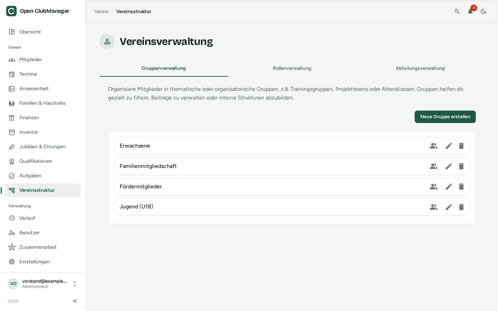

---
routes:
  - /entities
---

# Club structure

Sections, groups and roles make up your club's structure. Members can belong to several of them.

{ .screenshot }

| | Purpose | Examples |
|---|---|---|
| **Sections** | the club's divisions; help to differentiate fees and split statistics | football, gymnastics, kite, foil |
| **Groups** | thematic or organisational groups | training groups, age groups, project teams, adults, youth (U18) |
| **Roles** | members' positions and offices | board, treasurer, coach, youth officer |

!!! note "Roles here ≠ user roles"
    The roles of the club structure describe positions in the club. They grant **no** permissions in the program. What someone may do in the program is decided by their [user role](../erste-schritte/rollen.md).

## Adding and editing

Choose the tab at the top (groups, roles or sections) and click **Create New …**. Enter a name and description.

## Assigning members

Click the people icon (**Assign members**) on an entry. Search for members and tick them, so you can assign many members at once. Single assignments can also be changed in the [member dialog](mitglieder.md) under **Club Entities**.

Groups, sections and roles are also used as the **audience** of [events](termine.md) and for assigning [tasks](aufgaben.md).
