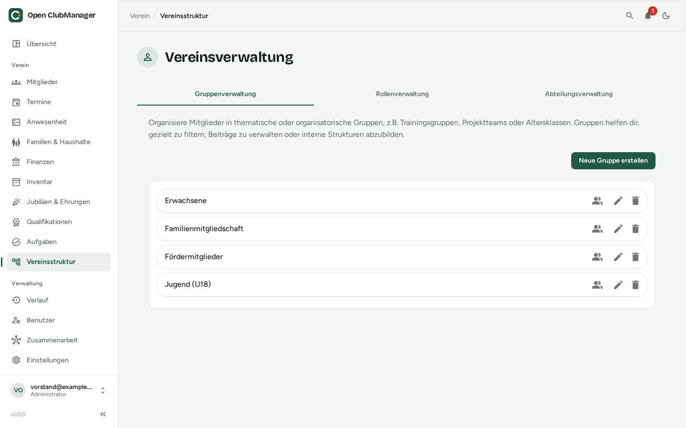

---
routes:
  - /entities
---

# Vereinsstruktur

Abteilungen, Gruppen und Rollen bilden die Struktur deines Vereins. Mitglieder können mehreren davon angehören.

{ .screenshot }

| | Wofür | Beispiele |
|---|---|---|
| **Abteilungen** | die Sparten des Vereins; helfen, Beiträge zu unterscheiden und Statistiken aufzuteilen | Fußball, Turnen, Kite, Foil |
| **Gruppen** | thematische oder organisatorische Gruppen | Trainingsgruppen, Altersklassen, Projektteams, Erwachsene, Jugend (U18) |
| **Rollen** | Funktionen und Ämter von Mitgliedern | Vorstand, Kassenwart, Trainer, Jugendwart |

!!! note "Rollen hier ≠ Benutzerrollen"
    Die Rollen der Vereinsstruktur beschreiben Ämter im Verein. Sie geben **keine** Rechte im Programm. Was jemand im Programm darf, legt die [Benutzerrolle](../erste-schritte/rollen.md) fest.

## Anlegen und bearbeiten

Wähle oben den Reiter (Gruppen, Rollen oder Abteilungen) und klicke auf **Neue … erstellen**. Gib Namen und Beschreibung ein.

## Mitglieder zuweisen

Klicke beim Eintrag auf das Personen-Symbol (**Mitglieder zuweisen**). Suche die Mitglieder und setze Häkchen – so ordnest du viele Mitglieder auf einmal zu. Einzelne Zuordnungen kannst du auch im [Mitglieder-Dialog](mitglieder.md) unter **Vereinsverwaltung** ändern.

Gruppen, Abteilungen und Rollen werden auch als **Zielgruppe** von [Terminen](termine.md) und bei der Zuständigkeit von [Aufgaben](aufgaben.md) verwendet.
