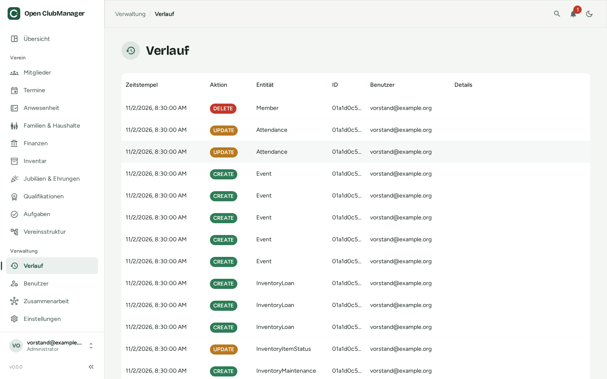

---
routes:
  - /history
---

# History

The history shows who changed what and when.

{ .screenshot }

Each entry contains:

| Column | Content |
|---|---|
| **Timestamp** | when the change was made |
| **Action** | CREATE, UPDATE or DELETE |
| **Entity** | what was changed, e.g. Member, Event, InventoryLoan |
| **ID** | the internal identifier of the entry |
| **User** | who made the change |
| **Details** | further information about the change |

The history helps with questions ("Who changed the address?") and as evidence for auditors. It cannot be edited.
