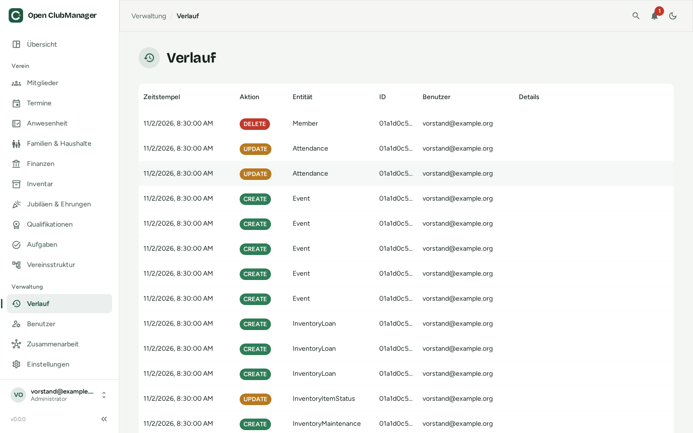

---
routes:
  - /history
---

# Verlauf

Der Verlauf zeigt, wer wann was geändert hat.

{ .screenshot }

Jeder Eintrag enthält:

| Spalte | Inhalt |
|---|---|
| **Zeitstempel** | wann die Änderung gemacht wurde |
| **Aktion** | CREATE (angelegt), UPDATE (geändert) oder DELETE (gelöscht) |
| **Entität** | was geändert wurde, z. B. Member, Event, InventoryLoan |
| **ID** | die interne Kennung des Eintrags |
| **Benutzer** | wer die Änderung gemacht hat |
| **Details** | weitere Angaben zur Änderung |

Der Verlauf hilft bei Rückfragen („Wer hat die Adresse geändert?“) und als Nachweis gegenüber Kassenprüfern. Er kann nicht bearbeitet werden.
