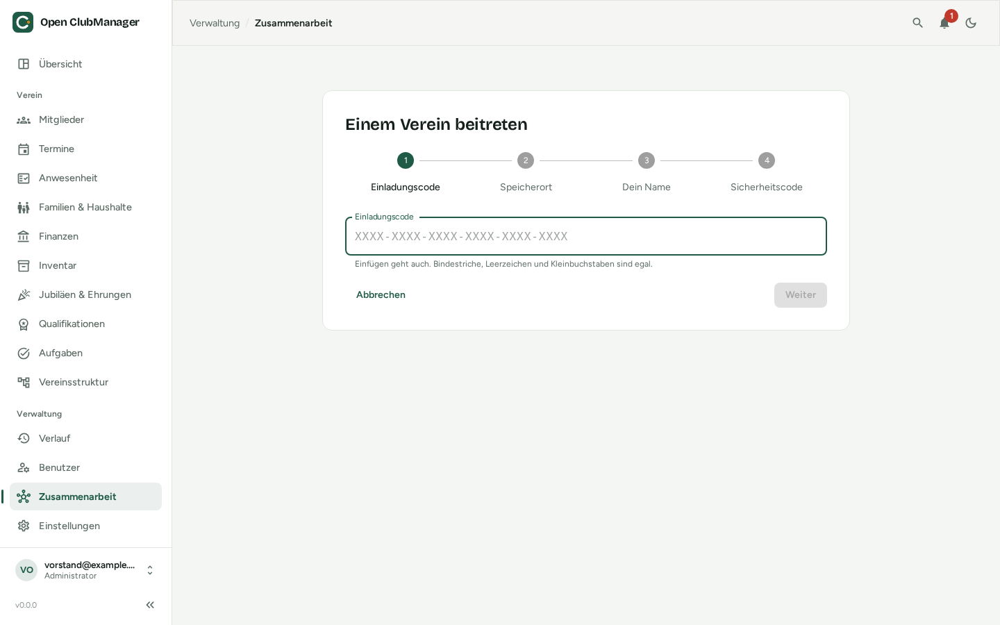

---
routes:
  - /collaboration/join
---

# Joining a club

You were invited and received an **invite code**? Here's how to join.

{ .screenshot }

## Before you start

- **Install** Open ClubManager and create your account during [first-run setup](../erste-schritte/einrichtung.md) (option: "Together with others – I have an invite").
- **Accept the folder share** you received from your club (Nextcloud, OneDrive, Dropbox, Google Drive …) and make sure the folder is synchronised to your computer.

## 1. Invite code

Type or paste the 24-character code. Hyphens, spaces and upper/lower case don't matter. The code is valid for 7 days and works only once.

## 2. Storage location

Choose the shared folder. Open ClubManager shows which club is in it.

!!! warning "Existing data on this device"
    If there is already club data on your device, it is **replaced** by the club's data. A backup is saved next to the database beforehand automatically. You have to agree to this explicitly.

## 3. Your name

Your name and the name of this device, so the others recognise you. Plus your password, which protects this device's key.

## 4. Safety code

You see a **6-digit safety code**. Tell it to the person who invited you, ideally **by phone**. You only get access once they confirm it.

You can close Open ClubManager in the meantime. As soon as you are approved, you see "Welcome! You're in" and your role.

Wrong code or wrong folder? **Cancel joining** withdraws your request – on this screen or under *Collaboration*. You can try again right away.

!!! info "Why a safety code?"
    The code makes sure that it really is **you** who used the invite, and not someone who intercepted the invite email.

## If it doesn't work

| Message | What to do |
|---|---|
| "We don't know this invite code" | Check the code or ask for a new invite. If the invite was created just now, wait until your sync app has updated the folder and try again |
| "There is no club in this folder" | Check that you accepted the share and your sync app is running |
| "The invite has expired / was already used" | Ask for a new invite |
| "This device was not admitted to the club" | The board rejected the request. Contact them; "Try again" lets you join anew |
