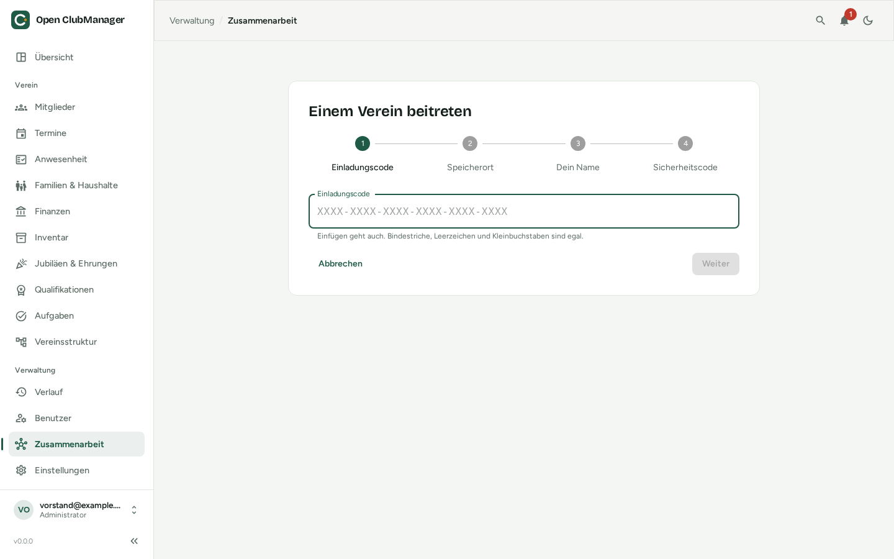

---
routes:
  - /collaboration/join
---

# Einem Verein beitreten

Du wurdest eingeladen und hast einen **Einladungscode** bekommen? So trittst du bei.

{ .screenshot }

## Vorher

- **Installiere** Open ClubManager und lege bei der [Ersteinrichtung](../erste-schritte/einrichtung.md) dein Konto an (Auswahl: „Gemeinsam mit anderen – ich habe eine Einladung“).
- **Nimm die Ordnerfreigabe an**, die du von deinem Verein bekommen hast (Nextcloud, OneDrive, Dropbox, Google Drive …), und sorge dafür, dass der Ordner auf deinem Computer synchronisiert wird.

## 1. Einladungscode

Gib den 24-stelligen Code ein oder füge ihn ein. Bindestriche, Leerzeichen und Groß-/Kleinschreibung sind egal. Der Code ist 7 Tage gültig und funktioniert nur einmal.

## 2. Speicherort

Wähle den freigegebenen Ordner. Open ClubManager zeigt an, welcher Verein darin liegt.

!!! warning "Vorhandene Daten auf diesem Gerät"
    Gibt es auf deinem Gerät schon Vereinsdaten, werden sie durch die Daten des Vereins **ersetzt**. Vorher wird neben der Datenbank automatisch eine Sicherung gespeichert. Du musst dem ausdrücklich zustimmen.

## 3. Dein Name

Dein Name und der Name dieses Geräts, damit die anderen dich erkennen. Dazu dein Passwort, das den Schlüssel dieses Geräts schützt.

## 4. Sicherheitscode

Du siehst einen **6-stelligen Sicherheitscode**. Nenne ihn der Person, die dich eingeladen hat – am besten **am Telefon**. Erst wenn sie ihn bestätigt, bekommst du Zugriff.

Du kannst Open ClubManager solange schließen. Sobald du bestätigt bist, siehst du „Willkommen! Du bist jetzt dabei“ und deine Rolle.

Falscher Code oder falscher Ordner? Mit **Beitritt abbrechen** ziehst du deine Anfrage zurück – auf diesem Bildschirm oder unter *Zusammenarbeit*. Danach kannst du es sofort noch einmal versuchen.

!!! info "Warum ein Sicherheitscode?"
    Der Code stellt sicher, dass wirklich **du** die Einladung benutzt hast und nicht jemand, der die Einladungs-E-Mail abgefangen hat.

## Wenn es nicht klappt

| Meldung | Was tun |
|---|---|
| „Diesen Einladungscode kennen wir nicht“ | Code prüfen oder neue Einladung anfordern. Wurde die Einladung gerade erst erstellt, warten, bis das Sync-Programm den Ordner abgeglichen hat, und erneut versuchen |
| „In diesem Ordner ist kein Verein“ | Prüfen, ob du die Freigabe angenommen hast und dein Sync-Programm läuft |
| „Die Einladung ist abgelaufen / wurde schon verwendet“ | Neue Einladung anfordern |
| „Dieses Gerät wurde nicht in den Verein aufgenommen“ | Der Vorstand hat die Anfrage abgelehnt. An ihn wenden; mit „Erneut versuchen“ kannst du neu beitreten |
