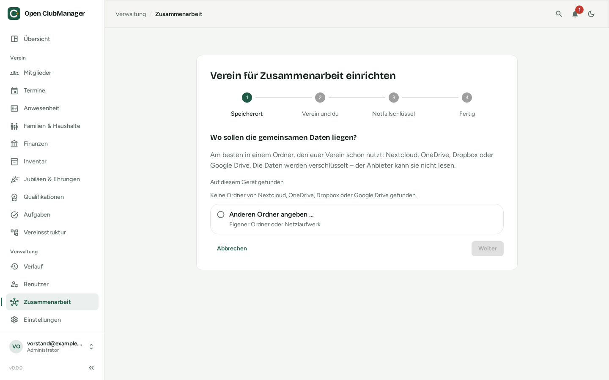

---
routes:
  - /collaboration/create
---

# Setting up a club for collaboration

**One** board member does this, once. They get the role **Board** and can then invite the others.

{ .screenshot }

Start via **Collaboration → Turn on collaboration** (or during first-run setup with "Together with others – set up a new club").

## 1. Storage location

Choose the shared folder. Open ClubManager lists Nextcloud, OneDrive, Dropbox and Google Drive folders it finds on your computer. **Enter another folder …** lets you enter your own path or a network drive (e.g. `\\clubserver\board` or `/Volumes/Club`).

Open ClubManager checks the folder:

- **is synchronised**: fine
- **network drive**: fine, if everyone can access it
- **doesn't seem to be synchronised**: then others can't access the data
- **not writable** or **doesn't exist**: check the path and your permissions

A subfolder "Open ClubManager – *club name*" is created in the folder.

## 2. Club and you

- **Club name**
- **Your name**: how the others see you
- **Name of this device**: e.g. "Laptop" or "Office PC"
- **Your password**: the password you log in to Open ClubManager with. It protects this device's key.

The data already on this device becomes the club's starting state.

## 3. Emergency key

Open ClubManager generates an **emergency key**. Without it, nobody can get to the club data again if all board devices are lost.

- **Print it** or save it as a file in a safe place, **not** in the shared folder.
- As a check, you type the last 4 characters of the "check:" line.
- After that step Open ClubManager does **not** keep the key.

More under [Emergency key](notfallschluessel.md).

## 4. Done

Next, [invite the others](personen-geraete.md#inviting-a-person).
