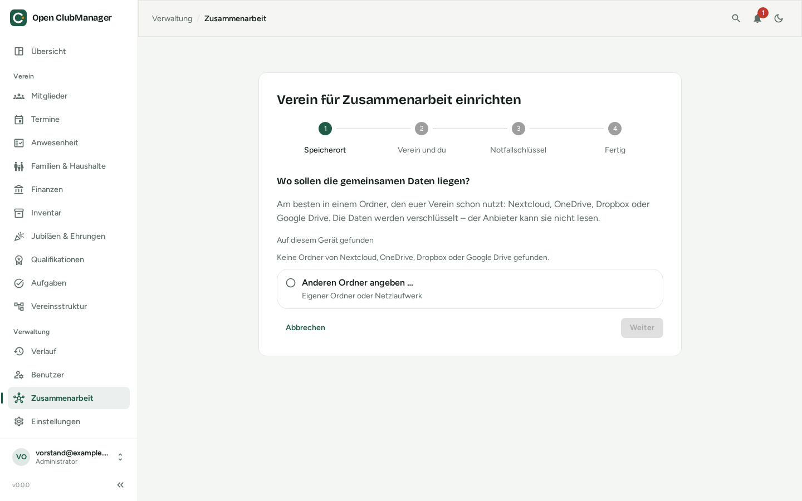

---
routes:
  - /collaboration/create
---

# Verein für Zusammenarbeit einrichten

Das macht **eine** Person aus dem Vorstand, einmalig. Sie bekommt dabei die Rolle **Vorstand** und kann danach die anderen einladen.

{ .screenshot }

Starte über **Zusammenarbeit → Zusammenarbeit einschalten** (oder bei der Ersteinrichtung mit „Gemeinsam mit anderen – neuen Verein einrichten“).

## 1. Speicherort

Wähle den gemeinsamen Ordner. Open ClubManager zeigt Ordner von Nextcloud, OneDrive, Dropbox und Google Drive an, die es auf deinem Computer findet. Mit **Anderen Ordner angeben …** gibst du einen eigenen Pfad oder ein Netzlaufwerk an (z. B. `\\vereinsserver\vorstand` oder `/Volumes/Verein`).

Open ClubManager prüft den Ordner:

- **wird synchronisiert** – passt
- **Netzlaufwerk** – passt, wenn alle darauf zugreifen können
- **scheint nicht synchronisiert zu werden** – andere können dann nicht auf die Daten zugreifen
- **nicht beschreibbar** oder **existiert nicht** – Pfad und Berechtigung prüfen

Im Ordner wird ein Unterordner „Open ClubManager – *Vereinsname*“ angelegt.

## 2. Verein und du

- **Vereinsname**
- **Dein Name** – so sehen dich die anderen
- **Name dieses Geräts** – z. B. „Laptop“ oder „Büro-PC“
- **Dein Passwort** – das Passwort, mit dem du dich in Open ClubManager anmeldest. Es schützt den Schlüssel dieses Geräts.

Die Daten, die schon auf diesem Gerät sind, werden zum Startstand des Vereins.

## 3. Notfallschlüssel

Open ClubManager erzeugt einen **Notfallschlüssel**. Ohne ihn kommt niemand mehr an die Vereinsdaten, wenn alle Vorstandsgeräte verloren gehen.

- **Drucke ihn aus** oder speichere ihn als Datei an einem sicheren Ort – **nicht** im gemeinsamen Ordner.
- Zur Kontrolle tippst du die letzten 4 Zeichen der Zeile „check:“ ab.
- Open ClubManager speichert den Schlüssel danach **nicht**.

Mehr dazu unter [Notfallschlüssel](notfallschluessel.md).

## 4. Fertig

Als Nächstes [lädst du die anderen ein](personen-geraete.md#person-einladen).
