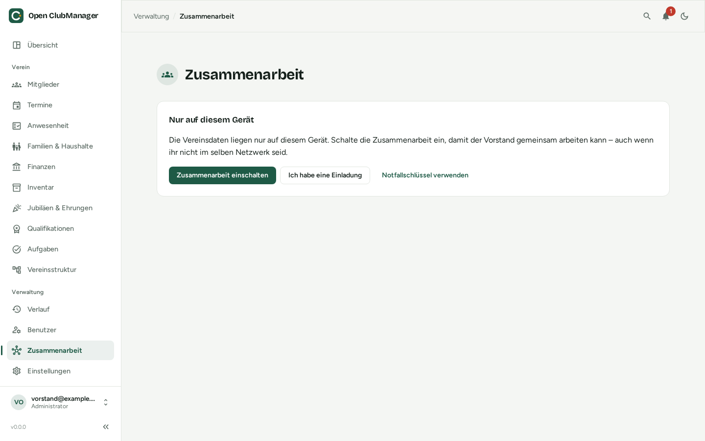

---
routes:
  - /collaboration
---

# Collaboration

With collaboration, several board members work with the same club data, each on their own computer, even if you are not on the same network.

{ .screenshot }

!!! warning "Still in development"
    Collaboration is new. Try it out, but only rely on it for real bank details once version 1.0 is released and the design has been reviewed by cryptography experts.

## How it works

```
 Chair's laptop            Treasurer's PC           Coach's laptop
 ┌──────────────┐          ┌──────────────┐          ┌──────────────┐
 │  own data    │          │  own data    │          │  own data    │
 └──────┬───────┘          └──────┬───────┘          └──────┬───────┘
        │      encrypted, signed changes                    │
        └───────────────►  shared folder  ◄─────────────────┘
               (Nextcloud, OneDrive, Dropbox, Google Drive, network drive)
```

- **Every device has its own database.** You always work locally and fast, even without internet.
- **Changes are exchanged, not the database.** Every change is encrypted, signed by the device and stored as a file in the shared folder. The other devices pick it up from there.
- **The folder only sees encrypted data.** Neither your cloud provider nor anyone opening the folder can read member or bank data.
- **Permissions are enforced technically.** A device with the coach role never receives the key for bank details, so it can't read them even if someone opens the files directly.
- **No server needed.** You use a folder the club already has.

## What you need

1. A **shared folder** that everyone involved can write to and that is synchronised to their computers by the sync app of Nextcloud, OneDrive, Dropbox or Google Drive. A network drive works too if everyone can reach it (e.g. via VPN).
2. Open ClubManager on every device.
3. One board member who [sets up](einrichten.md) the club and [invites](personen-geraete.md#inviting-a-person) the others.

## Sync status

An icon in the header shows the state of collaboration:

| Display | Meaning |
|---|---|
| **Everything is in sync** | Your changes are in the folder, the others' changes have arrived. |
| **Synchronizing …** | Open ClubManager is exchanging changes (automatically every 30 seconds). |
| **Storage location not reachable** | The folder isn't available right now (e.g. offline). You can keep working; your changes wait and are transferred later. |
| **Please have a look** | There are [conflicts to resolve](konflikte.md), join requests or a problem. |
| **Waiting for your request to be approved** | You asked to join and the board still has to approve. |

**Synchronize now** starts the exchange immediately.

!!! info "How fast do changes arrive?"
    Open ClubManager itself checks every 30 seconds. How quickly a change reaches the others' folders depends on your cloud provider's sync app, usually seconds to a few minutes.

## Simultaneous changes

If two people change **different fields** of the same member at the same time (one the address, the other the IBAN), both changes are kept. If both change **the same field**, the later change wins.

Values that must be unique (membership numbers, email addresses, names of groups and sections) can end up assigned twice. This is shown under [Needs attention](konflikte.md).

## Pages in this section

- [Set up a club](einrichten.md)
- [Join a club](beitreten.md)
- [Manage people & devices](personen-geraete.md)
- [Needs attention](konflikte.md)
- [Emergency key](notfallschluessel.md)
