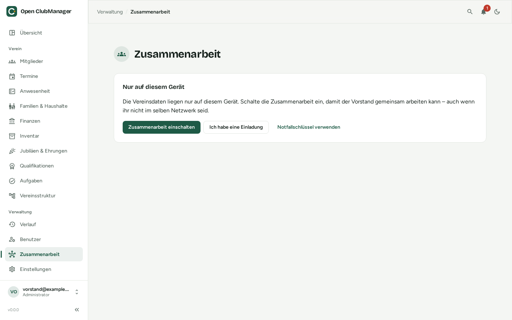

---
routes:
  - /collaboration
---

# Zusammenarbeit

Mit der Zusammenarbeit arbeiten mehrere Personen aus dem Vorstand mit denselben Vereinsdaten – jede auf ihrem eigenen Computer, auch wenn ihr nicht im selben Netzwerk seid.

{ .screenshot }

!!! warning "Noch in Entwicklung"
    Die Zusammenarbeit ist neu. Probiere sie aus, aber verlasse dich für echte Bankdaten erst darauf, wenn Version 1.0 erschienen ist und das Verfahren von Fachleuten für Kryptografie geprüft wurde.

## So funktioniert es

```
 Laptop Vorstand           PC Kassierer            Laptop Übungsleiterin
 ┌──────────────┐          ┌──────────────┐          ┌──────────────┐
 │ eigene Daten │          │ eigene Daten │          │ eigene Daten │
 └──────┬───────┘          └──────┬───────┘          └──────┬───────┘
        │   verschlüsselte, unterschriebene Änderungen      │
        └───────────────►  gemeinsamer Ordner  ◄────────────┘
                (Nextcloud, OneDrive, Dropbox, Google Drive, Netzlaufwerk)
```

- **Jedes Gerät hat seine eigene Datenbank.** Du arbeitest immer lokal und schnell, auch ohne Internet.
- **Änderungen werden ausgetauscht, nicht die Datenbank.** Jede Änderung wird verschlüsselt, vom Gerät unterschrieben und als Datei im gemeinsamen Ordner abgelegt. Die anderen Geräte holen sie sich von dort.
- **Der Ordner sieht nur verschlüsselte Daten.** Weder euer Cloud-Anbieter noch jemand, der den Ordner öffnet, kann Mitglieder- oder Bankdaten lesen.
- **Rechte sind technisch abgesichert.** Ein Gerät mit der Rolle Übungsleiter bekommt den Schlüssel für Bankdaten gar nicht – es kann sie also auch nicht lesen, wenn jemand die Dateien direkt öffnet.
- **Kein Server nötig.** Ihr nutzt einen Ordner, den der Verein schon hat.

## Was ihr braucht

1. Einen **gemeinsamen Ordner**, auf den alle Beteiligten Schreibzugriff haben und der auf ihren Computern synchronisiert wird – über das Sync-Programm von Nextcloud, OneDrive, Dropbox oder Google Drive. Ein Netzlaufwerk geht auch, wenn alle es erreichen (z. B. per VPN).
2. Open ClubManager auf jedem Gerät.
3. Eine Person aus dem Vorstand, die den Verein [einrichtet](einrichten.md) und die anderen [einlädt](personen-geraete.md#person-einladen).

## Der Sync-Status

Oben in der Kopfzeile zeigt ein Symbol den Stand der Zusammenarbeit:

| Anzeige | Bedeutung |
|---|---|
| **Alles synchronisiert** | Deine Änderungen sind im Ordner, die der anderen sind da. |
| **Wird synchronisiert …** | Open ClubManager tauscht gerade Änderungen aus (automatisch alle 30 Sekunden). |
| **Speicherort nicht erreichbar** | Der Ordner ist gerade nicht da (z. B. offline). Du kannst normal weiterarbeiten; deine Änderungen warten und werden später übertragen. |
| **Bitte ansehen** | Es gibt [Klärungsbedarf](konflikte.md), Beitrittsanfragen oder ein Problem. |
| **Warte auf Bestätigung** | Du hast den Beitritt angefragt, der Vorstand muss noch zustimmen. |

Mit **Jetzt synchronisieren** stößt du den Austausch sofort an.

!!! info "Wie schnell kommen Änderungen an?"
    Open ClubManager selbst schaut alle 30 Sekunden nach. Wie schnell eine Änderung im Ordner der anderen ankommt, hängt aber vom Sync-Programm eures Cloud-Anbieters ab – meist Sekunden bis wenige Minuten.

## Gleichzeitige Änderungen

Ändern zwei Personen gleichzeitig **unterschiedliche Felder** desselben Mitglieds (z. B. die eine die Adresse, der andere die IBAN), bleiben beide Änderungen erhalten. Ändern beide **dasselbe Feld**, gewinnt die zeitlich spätere Änderung.

Werte, die eindeutig sein müssen – Mitgliedsnummern, E-Mail-Adressen, Namen von Gruppen und Abteilungen – können dabei doppelt vergeben werden. Das wird unter [Klärungsbedarf](konflikte.md) angezeigt.

## Seiten in diesem Abschnitt

- [Verein einrichten](einrichten.md)
- [Einem Verein beitreten](beitreten.md)
- [Personen & Geräte verwalten](personen-geraete.md)
- [Klärungsbedarf](konflikte.md)
- [Notfallschlüssel](notfallschluessel.md)
